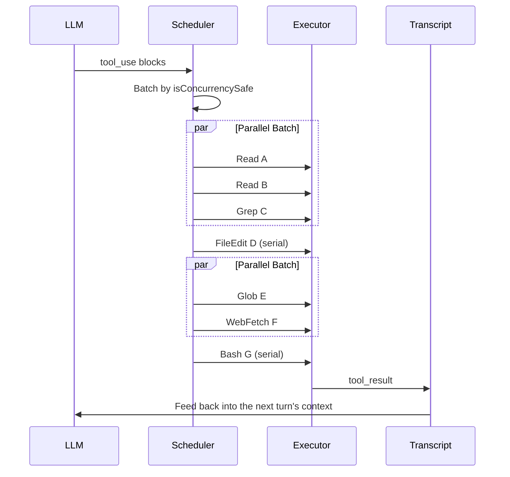

## Claude Code source code analysis: overview

Claude Code's value lies in the design of its harness. I divide it into four parts:

1. Runtime core
2. State continuity
3. Safety and extensibility
4. Key takeaways

## Agent Runtime

User input does not simply go straight to the model. It passes through a full runtime chain: local assembly -> permissions -> tools -> memory.

```javascript
ENTRY CHAIN
cli.tsx                         // CLI entry point
    -> main.tsx                 // Main function
    -> init + setup             // Security initialization before trust is established
    -> lanchRepl()              // Start Ink + React; Ink is a framework for running React in the terminal.
    -> App + REPL               // TUI and AppState (Read–Eval–Print Loop)
    -> query()                  // Run the core loop
        -> api.stream(msgs)     // Call the Claude API
        -> runTools(...)        // Tool concurrency + permissions + hooks
        -> compact / hooks      // Turn cleanup + memory extraction
        -> tool_result fed back // Next turn
```

Security initialization before trust is established mainly checks whether the current directory is trusted, checks whether tools such as file writes and shell commands are allowed, and initializes the permission system, similar to the sandbox in Cursor or Windsurf.

```javascript
main.tsx (main logic pseudocode)

async function main(argv) {
    await init(argv)                        // Security initialization before trust is established
    if (argv.print) return runHeadless()    // no GUI mode
    if (argv.bridge) return runBridge()     // IDE Plugin
    if (argv.remote) return runRemote()     // SSH, cloud mode
    // Default path: full runtime
    const tools = getTools(permCtx)
    const mcp = await getMcpTools()
    const skills = initBundledSkills()
    const agents = getAgentDefs()
    await initTelemetryAfterTrust()         // Runtime event reporting for the Claude Code team's improvements; think of it as a cross-cutting concern in Spring AOP.
    await launchRepl(...)
}
```

All execution modes (REPL/headless/SDK/bridge/remote/subagent) share the same Query() core implementation.

## Query Loop

Six phases plus AsyncGenerator backpressure let long conversations continue through errors, limit overruns, and interruptions.

```javaScript
query.ts

async functions* query(state) {
    while (true) {
        yield* preApiPhase(state)                       // 1. Assemble attachments / skills / memory
        const res = yield* apiRequestPhase(state)       // 2. Streaming API + retries
        const t = yield* processResponse(res, state)    // 3. Parse -> Transition
        if (t === 'tool_use') yield* executeTools(state)// 4. Concurrency + permissions + hooks
        if (shouldStop(t)) yield* runStopHooks(state)   // 5. Post-turn hooks
        if (shouldExit(t)) break                        // 6. Check whether to exit
        state.turnCount++
    }
}
```

state = the current REPL's full context (messages, tools, turnCount, memory, etc.).

transition = the next action the runtime should take after the LLM produces output.

Output is streamed. While the frontend displays it, the next step has already been invoked, which makes the interaction feel smooth.

**Transition states:**
```
continue            Proceed normally to the next turn
tool_use            Execute tools
end_turn            Model ends the turn voluntarily
stop_sequence       Stop sequence reached
max_tokens          Output limit reached
error_recovery      Enter error recovery
budget_exceeded     Budget limit / diminishing returns
abort               User cancellation
```

### Seven-level error recovery cascade

```
L1: Streaming fallback
// Streaming fallback: if streaming is interrupted by a network issue or model interruption, switch to a non-streaming request to finish the current turn.

L2: Collapse
// Context collapse: automatically compress messages by merging history, removing redundancy, or shortening tool logs to reduce token pressure and avoid context-size failures.

L3: Reactive compact
// Reactive compaction: when the model returns an error or incomplete output, immediately compact context more aggressively by removing old turns or trimming long content, then retry.

L4: Max output escalation
// Maximum output escalation: if max_tokens interrupts the model, increase max_tokens or retry in a mode with a larger budget.

L5: Multi-turn continue
// Multi-turn continuation: if output is truncated or the logic is unfinished, automatically send a continuation request so the model resumes from where it stopped.

L6: Stop hook blocking
// Stop hook blocking: if stop_sequence or end_turn fires too early, block stopping through the stop hook so generation continues until the task is complete.

L7: Budget continuation
// Budget continuation: when a budget limit is reached, such as diminishing returns or a cost cap, continue in a lower-cost mode, for example with shorter context or lower frequency.
```

A state machine that does not give up easily: recovery progresses from lighter to heavier interventions.

L1–L2: lightweight recovery (network or context issues)

L3–L4: moderate recovery (incomplete model output)

L5–L6: logical recovery (the model stops too early)

L7: budget recovery (cost or limit issues)

## Tool runtime protocol objects

Claude Code defines tools as standardized protocol objects rather than a mapping of functions. Safety is not just an outer wrapper: every tool must follow the protocol internally.

```js
// Tool interface (src/Tool.ts; extensively extensible)
type Tool = {
  name
  description()
  inputSchema
  call(input, context, canUseTool)

  // Runtime governance
  isReadOnly()
  isConcurrencySafe()
  checkPermissions()

  // UI / how results are presented and replayed
  renderToolUseMessage()
  mapToolResultToToolResultBlockParam()
}
```

```js
// buildTool (src/Tool; safe defaults)

const TOOL_DEFAULTS = {
  isEnabled: true,

  // Concurrency is opt-in; run serially unless declared otherwise
  isConcurrencySafe: false,

  // Not read-only unless explicitly declared
  isReadOnly: false,

  isDestructive: false,

  checkPermissions: allow,

  toAutoClassifierInput: '',

  userFacingName: name,
}

function buildTool(def) {
  return {
    ...TOOL_DEFAULTS,
    ...def,
  }
}
```

### Three: a Tool is a standardized protocol object, not a function mapping

The same definition supports all of the following:

- Model invocation
- Permission checks
- Concurrency scheduling
- UI presentation
- Feeding results back

---

### From interface to instance

`Tool.ts` defines the complete runtime protocol:

- Model-facing description
- Input schema
- Execution function
- Permission checks
- Concurrency properties
- UI rendering
- Result mapping

Each concrete tool declares a `ToolDef` in its own file, for example:

- `BashTool`
- `FileReadTool`
- `TodoWriteTool`

These definitions provide the tool-specific logic.

`buildTool` only fills in `DefaultableToolKeys`.

---

### Design implications

Tool authors focus on specialized behavior.

Shared defaults are maintained centrally in `buildTool`.

The spread order is:

```js
defaults -> def
```

Explicit declarations in a concrete tool therefore override the defaults.

This brings new tools into a unified set of mechanisms by default:

- Permissions
- Concurrency
- Presentation
- Result feedback

## Four: tool execution through a governed pipeline

> A Tool protocol becomes a controlled, potentially concurrent action that writes back to the transcript only when it enters the scheduler.

---

### The complete tool call chain

```js
// The model outputs an assistant message
//   ↓ Contains one or more tool_use blocks

query.ts collects tool_use

//   ↓

toolOrchestration.ts batches by isConcurrencySafe

//   ↓

toolExecution.ts executes each tool

//   ├─ schema validation
//   ├─ validateInput
//   ├─ pre-tool hooks
//   ├─ permission / ask / deny
//   ├─ tool.call()
//   ├─ tool_result / attachment / progress
//   └─ Normalize into user-side tool_result messages

//   ↓

Feed the transcript back into the next API call
```

### Tool concurrency strategy



### Execution details

- (1) getTools() / assembleToolPool() constructs the tool pool. Built-in and MCP tools are merged before entering the execution chain.
- (2) contextModifier updates from a concurrent batch are collected and deferred, then applied together after the entire batch finishes to avoid context races.
- (3) StreamingToolExecutor tracks queued -> executing -> completed -> yielded states, launching tools that can run in parallel as streaming `tool_use` blocks arrive.

---


