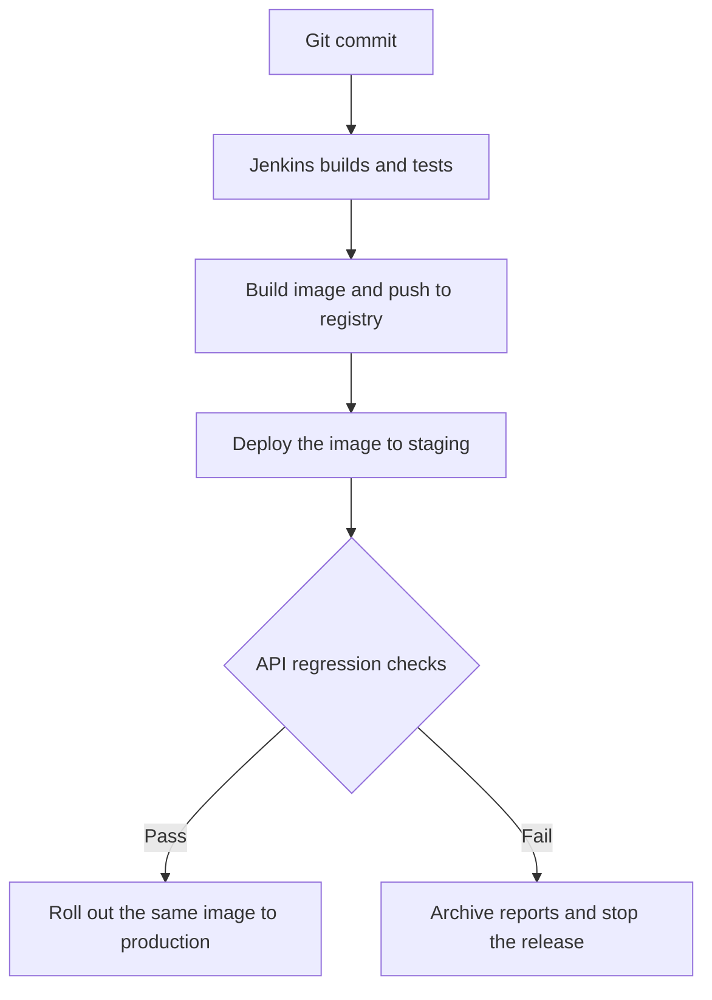

A release pipeline should make it possible to answer three questions: which commit is running, which tests passed for that exact artifact, and how traffic can move away from it if the release fails.

## Jenkins and CI/CD

Jenkins can check out a commit and run build, test, and deployment stages defined in a version-controlled `Jenkinsfile`. Configure a build agent with the required JDK and tools, trigger CI from a GitHub event, and publish test reports. Use managed credentials for registry and deployment access, and notify the team when a stage fails.

Continuous integration builds and tests changes as they are integrated. Continuous delivery keeps a tested artifact ready to release, possibly with approval. Continuous deployment automatically releases passing changes.



## Docker and Compose

An image packages the application and its runtime. A container is an instance of that image. The Docker CLI or Desktop UI talks to a daemon that builds images and manages containers. A registry such as Docker Hub stores versioned images for deployment.

```dockerfile
FROM eclipse-temurin:17-jre
WORKDIR /app
COPY target/my-springboot-app.jar app.jar
EXPOSE 8080
ENTRYPOINT ["java", "-jar", "app.jar"]
```

Build the jar first. Tag the image with a commit or release identifier, and promote the same image digest between environments. Inject environment configuration at runtime. A Compose YAML file defines the services, networks, and volumes for a local multi-container setup, such as a Spring Boot app and database.

## Kubernetes and EKS

A Kubernetes Deployment manages replicas and replaces pods when its pod template changes. A Service provides a stable endpoint for the replicas. A readiness probe controls when a new pod can receive traffic. Amazon EKS is a managed Kubernetes service. Application image versions, capacity, rollout, and health checks still need to be configured. [Kubernetes Deployments](https://kubernetes.io/docs/concepts/workloads/controllers/deployment/).

## Safe rollouts and rollback

- **Rolling update.** Replace replicas gradually while maintaining enough ready capacity. Drain inflight requests before terminating pods.
- **Blue-green.** Run both complete environments, validate the new one, and move traffic to it. Keep capacity for both during the cutover and a way to switch back.
- **Canary.** Start with a small fraction of traffic and compare errors, latency, and business outcomes before widening the rollout.

Keep APIs and schemas compatible with both versions while traffic overlaps. An image rollback cannot automatically undo a destructive migration or a side effect already published to a queue.

## TDD and regression gates

Test-driven development starts with a failing test for a specific behavior, adds the smallest implementation that passes, and then refactors. CI builds on these tests. Unit tests catch local behavior changes, while API regression suites check the deployed service's contracts. Run the latter against a test environment with known fixtures and archive the results before promoting a release.

## Newman API regression reports

The following Bash example runs each Postman collection in a directory against a selected test environment and writes a separate JUnit report per collection. Install or pin Newman in the CI environment. Manage any secrets outside the exported environment file.

```bash
#!/usr/bin/env bash
set -euo pipefail
shopt -s nullglob

environment=${1:-QA}
collections=(collections/*.postman_collection.json)
if (( ${#collections[@]} == 0 )); then
    echo "No Postman collections found" >&2
    exit 1
fi

mkdir -p reports
status=0
for collection in "${collections[@]}"; do
    name=$(basename "$collection" .postman_collection.json)
    if ! newman run "$collection" \
        -e "environments/${environment}.postman_environment.json" \
        -r cli,junit --reporter-junit-export "reports/${name}.xml"; then
        status=1
    fi
done
exit "$status"
```

Archive the JUnit XML even when the job fails. If you need browser-readable output, add a compatible HTML reporter such as `newman-reporter-htmlextra` and archive a separate HTML report per collection. The built-in CLI reporter gives immediate feedback in the job log. [Postman Newman CLI](https://learning.postman.com/docs/reference/newman-cli/command-line-integration-with-newman/).
