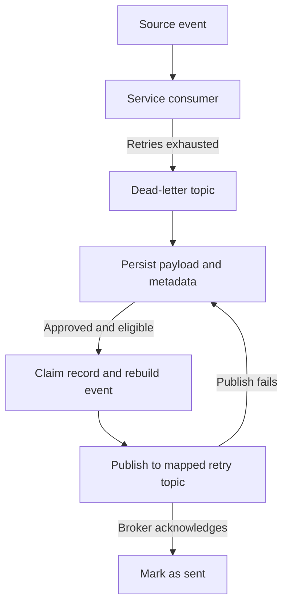

Kafka stores events in a retained log. That makes it useful when several consumers need to read the same history at their own pace. RabbitMQ typically routes messages through exchanges to queues whose consumers acknowledge work. Both can run as clusters. Choose based on whether retained history and replay or queue routing and delivery behavior are central to the application.

## Kafka record

A record can contain a key, value, timestamp, and headers. Keys often represent an entity, such as an account. A null value can represent a tombstone on a compacted topic. Headers carry metadata such as a trace identifier or schema hint. Timestamps support time-based processing, while offsets give the position and order within a partition.

## Topics, partitions, and consumer groups

A topic contains one or more partitions. Each partition is an append-only log split into segment files. A producer chooses a partition, often based on a key, and uses cluster metadata to send the record to the leader. Keep a stable partitioning scheme when a consumer requires per-key order. Offsets from different partitions do not define a global order.

Each consumer group has its own offsets. Within a group, a partition is normally assigned to one consumer at a time. Adding consumers above the partition count leaves some idle. If a consumer leaves, the group reassigns its partitions. The next consumer resumes from the committed offset. A consumer that finishes a side effect and then crashes before committing can receive that record again. Reading does not delete records. Retention and compaction determine when the log drops old data.

## Leader-follower replication

The replication factor counts replicas of each partition. Followers fetch from the leader and can qualify for promotion when they stay in sync. Kafka's controller manages metadata and leadership changes. Kafka 4 uses KRaft for cluster metadata. ZooKeeper appears in older deployments and migration guides. [Kafka upgrade guide](https://kafka.apache.org/40/getting-started/upgrade/).

With `acks=all`, the leader waits for the in-sync replicas. Configure `min.insync.replicas` together with the replication factor to control when the broker can acknowledge a write. For example, with three replicas and a minimum of two in sync, the leader can reject writes rather than acknowledge them with only one replica in sync.

## Throughput, retention, and hot partitions

Dividing 1 GiB/s of disk bandwidth by 10 KiB per event gives roughly 105,000 events/s as a rough disk-only ceiling. Measure the real limit with replication, consumer fetches, network, serialization, and p99 latency in the workload. Similarly, a 10 KiB payload target is an application budget, not a Kafka limit. Batch records and tune `linger.ms`, `batch.size`, and `compression.type` together. Avro is a serialization format. Kafka's compression codec handles compressing batches.

A hot key can overload one partition even with spare brokers. Adding partitions helps only when work can be distributed among them. A compound key or salted key can spread work at the cost of losing order across shards of the original key. If order matters, keep the key intact and use backpressure, reduce work per record, or redesign the aggregation. `retention.ms` and `retention.bytes` control log deletion for delete-policy topics. A compacted topic retains the latest values by key subject to its compaction and deletion policies.

## Handling retries and errors

### Producer retries

Network or broker failures can leave a send outcome uncertain. Let the producer retry transient errors within a delivery timeout and keep idempotent production enabled. These settings are for the Java producer. With string keys and Avro values, use a string serializer for the key, an Avro serializer for the value, and supply the Schema Registry URL separately.

```properties
acks=all
enable.idempotence=true
delivery.timeout.ms=120000
linger.ms=5
batch.size=16384
compression.type=lz4
```

Producer idempotence prevents duplicate appends from its protocol retries. If application code independently issues a second send for the same business event, use an event ID and a deduplication strategy. [Kafka producer configuration](https://kafka.apache.org/40/configuration/producer-configs/).

### Consumer retries

Commit progress after processing or after durably handing off the record. Retry transient failures with a limit. Malformed records and permanent validation failures can go directly to a dead-letter topic. Moving a failed record to a separate retry topic lets the main consumer keep going, but events for the same entity may then be processed out of order. If preserving order is essential, pause or retry on the original partition and account for the resulting lag.

## Dead-letter queue and controlled replay

A handler service can use a Spring Kafka listener to persist failed events and a worker to reconstruct and republish eligible events to a configured retry topic. Store the original bytes when deserialization fails. If the event was converted to JSON, keep enough schema information to rebuild the correct Avro type later.



| Keep with the failed event | Why |
| --- | --- |
| Original topic, partition, offset, event ID | Locate and deduplicate the event. |
| Failure type, reason, and source service | Distinguish transient failure, invalid data, and deserialization errors. |
| Schema ID or name and version | Reconstruct the record using the writer schema. |
| Status, attempt count, and timestamps | Bound retries and give operators an audit trail. |

Claim eligible rows atomically if multiple workers poll the table. For a limit of three retries, allow attempts while the retry count is below three. A crash after publishing but before marking the row as sent can cause duplicate replay. Keep a stable ID and make the receiver idempotent. A broker acknowledgement means the record was published, while a separate signal is needed to know the business operation succeeded. [Further reading on Kafka dead-letter queues](https://www.kai-waehner.de/blog/2022/05/30/error-handling-via-dead-letter-queue-in-apache-kafka/).

### Operating a Kafka dead-letter topic

The consumer application, framework, or connector decides when a record goes to a dead-letter topic. Retry a transient outage with a limit. Quarantine incompatible schemas, malformed payloads, and permanent validation errors for investigation. Advance the source offset only after the failure record is durably handed off. Check how publish failures are surfaced by your handler. [Spring Kafka error handling](https://docs.spring.io/spring-kafka/reference/kafka/annotation-error-handling.html).

Monitor new failed records by source and reason, the age of the oldest unresolved record, retention headroom, and replay outcomes. If failures spike after a deployment, check schema and connector configuration before replaying. Once the fix is in place, replay a small batch and check the outcomes before scaling up. Confluent Cloud sink connectors can expose failure details in dead-letter record headers. [Confluent connector DLQ documentation](https://docs.confluent.io/cloud/current/connectors/dead-letter-queue.html).

For cache projections, reconciliation and stateful stream processing, continue with [Event Processing with Kafka, Redis, and Flink](/blog/DistributedSystem/2025-03-04-Flink).
