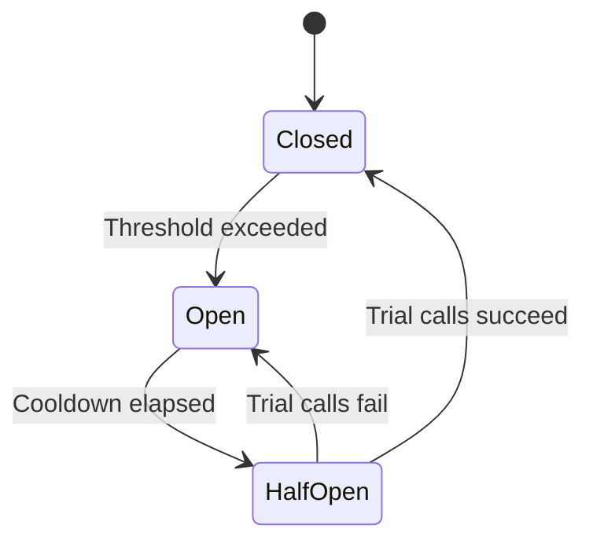

A slow account service can affect an entire application. If callers keep connections open while waiting, then all retry at once, a partial slowdown can become a system-wide outage. Follow the request from the edge to each dependency and decide what the caller can still do when a dependency is slow or unavailable.

## Monolith versus microservices

A monolith is deployed as one unit. It can still be modular internally and run on multiple replicas. Use it when modules change together or when local calls and a single database transaction simplify the work. Split a module into a service when independent deployments, ownership, or scaling justify the network calls and operational overhead. A boundary also means its data and failures need explicit contracts.

## API gateways and service discovery

An API gateway gives external clients a stable entry point. It can route a request directly or aggregate responses from several services. Common edge responsibilities include authentication, routing, rate limits, and load balancing. Keep resource-level authorization in the service that owns the data. An internal service need not call through the public gateway when service discovery can route it directly.

A registry such as Eureka maps a logical service name to instances. Instances renew leases with heartbeats. Clients can use a declarative HTTP client such as Feign with discovery and load balancing configured to call by service name. A registry entry is a routing hint. A stale entry can still point at an unhealthy service.

## Synchronous and asynchronous communication

| Use | Example | Tradeoff |
| --- | --- | --- |
| Synchronous HTTP | Checkout needs a price before it can show the total. | The caller waits and shares the dependency's latency and availability. Set timeouts within the end-to-end deadline. |
| Asynchronous messaging | Account creation publishes an event for email and notifications. | The account request can finish before the side effects. Consumers need idempotent handling and a way to recover failed messages. |

Use [Kafka retries and dead-letter handling](/blog/DistributedSystem/2024-06-15-kafka-basic#handling-retries-and-errors) for the second case and [distributed tracing](/blog/DistributedSystem/2024-10-05-Splunk-Logging#distributed-tracing) to follow work across service boundaries.

## Cascading failures and fault tolerance

A timeout caps how long the caller spends waiting. It does not prove that the callee stopped working, so retry only when duplicate execution is safe or when an idempotency key protects the operation. Use capped exponential backoff with jitter and a retry budget. If each layer retries independently, the last dependency can see far more calls than the client sent.

Use load balancing and readiness checks to avoid routing to unhealthy instances. Limit concurrent work per dependency so one overloaded service cannot fill every thread or connection. Shed load or return a safe fallback where possible. A stale recommendation list can be acceptable during an outage. A stale authorization decision may not be. [AWS Builders' Library on timeouts and retries](https://aws.amazon.com/builders-library/timeouts-retries-and-backoff-with-jitter/).

### Circuit breaker

A breaker observes failures for a dependency and stops sending requests when the failure threshold is exceeded. It operates alongside timeouts, which still bound individual calls.

Closed calls proceed normally. Open calls fail fast or use a fallback. Half-open permits only a limited number of trials, so recovery does not immediately flood the dependency.

## Failure detection

A missed heartbeat means a node is suspected. The cause could be a crash, a partition, a slow node, or a problem with the observer itself. Multiple observations can improve confidence, but no fixed number proves a remote node has crashed. Use the protocol appropriate to the decision. Removing an endpoint from traffic and electing a new write leader have different safety requirements.

### Gossip protocol

In a gossip-based membership system, nodes exchange membership versions or heartbeat counters with random peers. New information spreads over repeated rounds. A counter that stops advancing can cause a node to be suspected. This spreads membership information without a central observer, while different nodes may temporarily disagree.

### Replica recovery

A strict quorum counts responses from the intended replica set. In a Dynamo-style sloppy quorum, a healthy substitute can accept a write temporarily and leave a hint identifying its intended replica. Hinted handoff delivers that update when the replica returns. It improves availability but changes the guarantees of quorum overlap. For longer outages or missed hints, anti-entropy compares replica state, for example using Merkle trees, and repairs differences. Use versioning or a conflict resolution rule to decide which value wins. [Dynamo paper](https://www.allthingsdistributed.com/files/amazon-dynamo-sosp2007.pdf).
