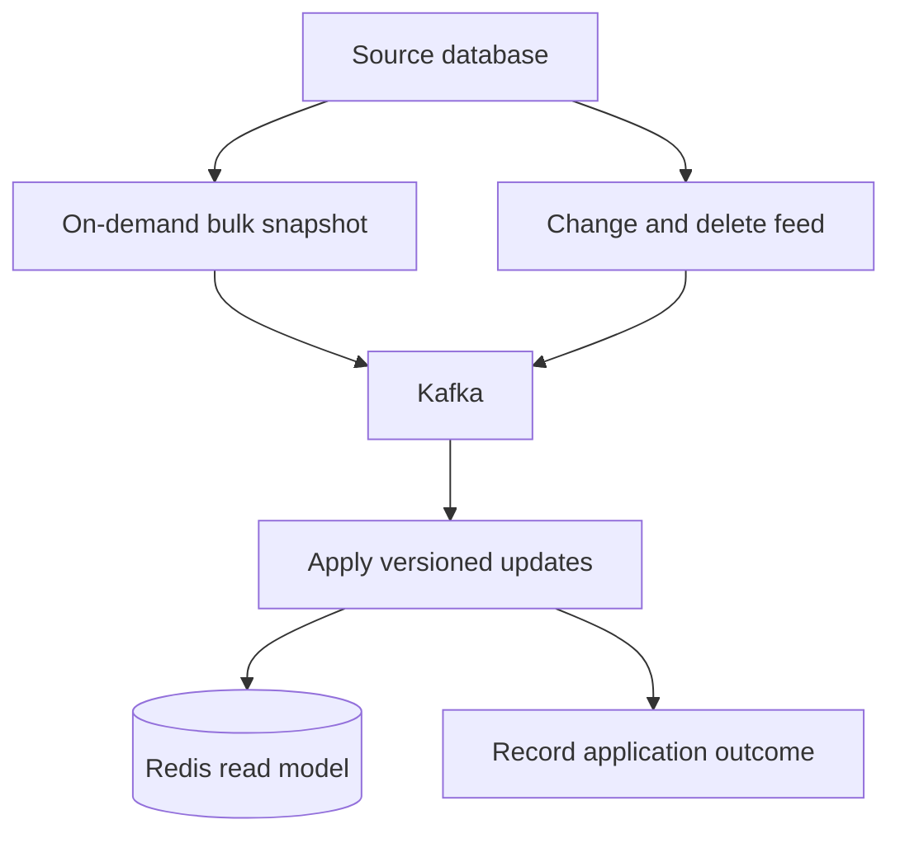

The simplest event consumer writes the latest version of each record into a read model. A stream processor earns its place when the result depends on multiple events or streams, such as correlating transactions over a time window.

## Kafka and Redis cache projections

In the account-data example, a client requests a bulk load and gets back an ID or cache lookup key. A producer reads a source database, publishes records to Kafka, and a consumer upserts them into a Redis read model. A separate change feed handles updates and deletes. Batching, for example 100 writes at a time, can improve throughput. Record only the progress of writes that actually succeeded.



Use a stable record key. If the snapshot and change feed overlap, an older snapshot row can arrive after a newer update or delete. Keep a source version or position and reject stale events, including stale writes following a deletion. Handle a key change as a delete of the old key and upsert of the new key. Make upserts and deletes safe to repeat when Kafka redelivers a batch.

## Reconcile published and applied events

Compare what the source published with what each consumer actually applied. Scope the comparison by topic or data set, subscriber, and time window. Allow for expected lag and classify mismatches as pending, missing, duplicate, or invalid.

| Evidence | Best use | Limitation |
| --- | --- | --- |
| Counts | Cheap signal for bulk loads and dashboards | A missing record and an extra one can cancel out. |
| Event IDs and timestamps | Identify individual missing or late events | Requires storing IDs and tracking progress per subscriber. |
| Digests | Detect altered values or content mismatches without storing the full body | Requires canonical encoding and a comparison that handles ordering and duplicates. A digest alone does not provide a replay payload. |
| Audit records | Explain changes and support targeted recovery | Requires retention and access controls. Keep full payloads only when needed. |

Start with counts and per-event identity or digests where required. Retain detailed audit data for flows that need it. Give operators a drilldown from a mismatch to its source and a controlled way to rerun a snapshot or replay a failed event. A rebalance can interrupt a batch, so record application progress durably and support replay. Treat invalid source data separately from delivery failures so replay does not keep reproducing the same invalid result.

## Concepts

Kafka is the retained event log. Kafka Streams is a JVM client library for processing Kafka data. Flink runs pipelines across workers, reading sources such as Kafka, CDC feeds, and files and writing to sinks such as databases, warehouses, queues, or files.

Use `map` and `flatMap` to transform events, `filter` to discard irrelevant ones, and `keyBy` to put work for the same key together. Keyed state can hold one value, a list, a map, or an incrementally maintained aggregate. Use joins or connected streams when one stream needs data from another.

## Event time, watermarks, and windows

Event time comes from the event. Processing time is when the operator sees it. Watermarks express progress in event time so an operator can close windows even when events arrive out of order. A bounded-out-of-orderness strategy trades latency for tolerance of delayed events. Without watermark progress, event-time windows may never fire. Use processing-time windows if the requirements are based on arrival time.

| Window | Example |
| --- | --- |
| Tumbling | Separate totals for 10:00–10:05 and 10:05–10:10. |
| Sliding | Every 5 minutes, measure the last 30 minutes. One event can contribute to multiple windows. |
| Session | Group activity until an inactivity gap ends the session. |

Decide how to handle data arriving after the watermark. Incremental aggregation keeps only a running result. A window function can add metadata or other window-level work.

## Cluster architecture and state backends

A JobManager coordinates scheduling, checkpoints, and recovery. TaskManagers execute operators using task slots. The state backend manages working state, for example on the heap or with embedded RocksDB. Durable checkpoint storage is a separate configuration decision. Choose it so losing one worker does not also lose the recovery point.

## Exactly-once processing and recovery

A checkpoint records operator state and the matching positions of replayable sources. If a task fails, Flink can restore affected work from a completed checkpoint and rewind the source to those positions. It may process some input again while reconstructing the state. End-to-end exactly-once effects need a sink that cooperates with checkpointing or idempotent writes. A checkpoint alone cannot prevent duplicate emails or inserts. [Flink fault tolerance](https://nightlies.apache.org/flink/flink-docs-stable/docs/learn-flink/fault_tolerance/).

## Example: transaction alerts

```text
Kafka transactions -> assign event time and watermarks
                   -> key by account and enrich from account updates
                   -> detect 3 or more transactions above $1,000 in a sliding 30-minute window
                   -> also detect a small charge followed by a large charge within 5 minutes per card
                   -> normalize the alert types, merge, and deduplicate by alert ID
                   -> publish alerts to Kafka and index them for investigation
```

The velocity rule uses keyed windows. The small-then-large sequence is a candidate for Flink CEP. Align both branches to a common alert type before merging them. Choose a deterministic alert ID so retries cannot create a second alert for the same event group. For failures outside the stream processor, see [dead-letter replay](/blog/DistributedSystem/2024-06-15-kafka-basic#dead-letter-queue-and-controlled-replay).
