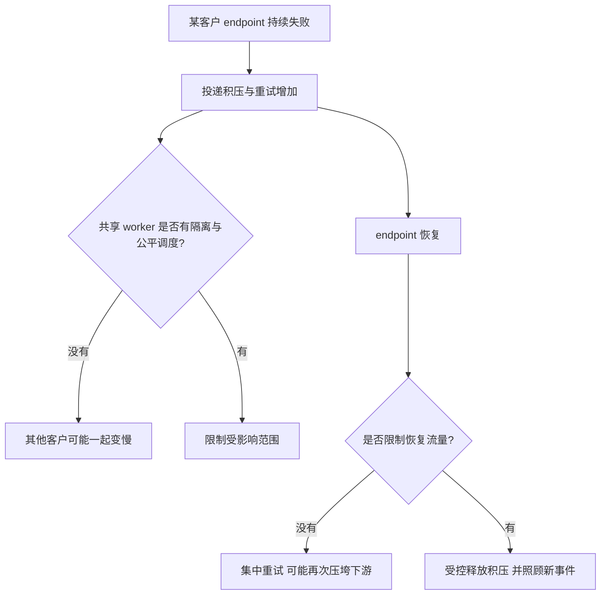
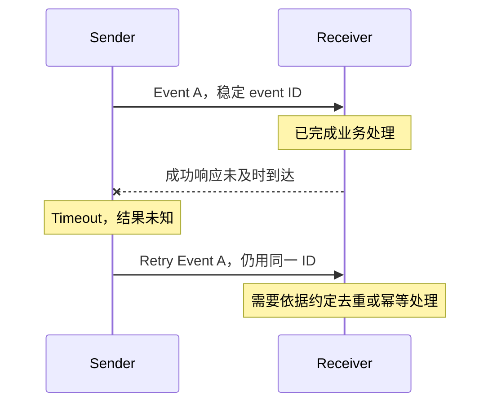
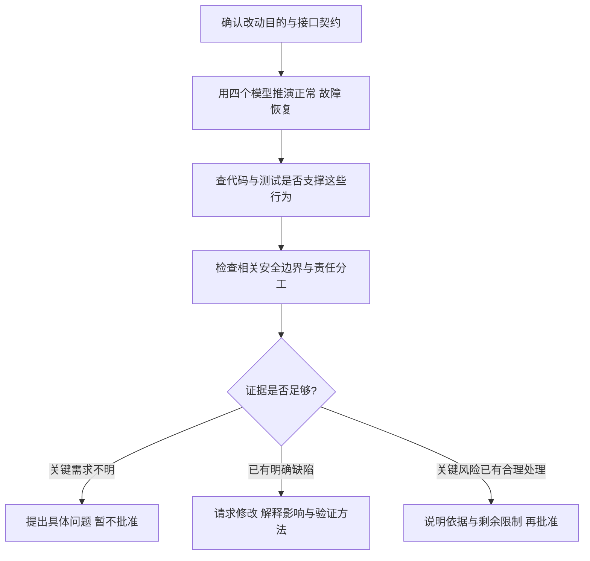

整理日期：2026-11-17。用途：PR review 学习与面试练习。

来源：依据一份视频摘要整理；未附原视频链接，视频及其中的面试场景未独立核实。安全、责任和部分决策细节属于学习补充，不作为视频原话。本文用于理解与练习，不代表特定公司的面试评分标准，也不作为个人已发生的工作经历。

## 1. 一句话记住核心

> **先问上线后会发生什么，再判断代码是否实现正确。**

代码整洁、有测试，只是证据的一部分。Review 还需要检查需求描述是否遗漏了关键约束。这套方法同样适用于人写的 PR。

**总路线：目的 → 行为与影响 → 安全 → 责任。**

**Retry 四问：能不能重？该不该重？等多久？拖累谁？**

```text
Intent                 Behavior & System Impact       Security       Ownership
为什么改？      →      上线后会怎样？            →     安全吗？   →   谁负责？
                           │
                           ├─ Contract：能不能重？重复 / 乱序 / 成功契约
                           ├─ Failure：该不该重？错误分类 / 结果未知
                           ├─ Time：等多久？等待 / 次数 / 有效期
                           └─ Capacity：拖累谁？积压 / 恢复 / 租户隔离
```

记忆提示：“能不能重”问的是业务是否允许重复、乱序，以及如何控制副作用；“该不该重”问的是当前失败是否值得再试。两个问题不要混在一起。

## 2. 用四层视角看一个 PR

| 层次 | 首先问什么 | 应当获得的判断依据 |
| --- | --- | --- |
| Intent：目的 | 解决哪个问题？原来怎样，现在准备怎样？ | 业务目标、非目标、验收条件；description 是否完整 |
| Behavior & System Impact：行为与影响 | 正常、失败、恢复时会发生什么？影响哪些上下游和客户？ | 契约、失败语义、时间约束、容量与隔离 |
| Security：安全 | 改动是否扩大访问范围、暴露数据或放大资源消耗？ | 与本次改动有关的安全边界与检查证据 |
| Ownership：责任 | 谁确认契约？谁处理失败？上线后怎样观察和恢复？ | 明确负责人、监控、失败处置、发布与回退安排 |

原摘要对后两层只给出了标题。本文后面的安全与责任问题是学习补充，不能当作视频已详细讲解的内容。

## 3. 四个模型：审查 retry 的判断锚点

| 模型 | 记忆问题 | 需要看什么 | 不能直接下的结论 |
| --- | --- | --- | --- |
| **Contract 契约** | **能不能重？** | 什么响应算投递成功；稳定 event ID；接收方去重；乱序能否接受；顺序范围 | “有 idempotency key 就不会重复执行” |
| **Failure 失败** | **该不该重？** | 参数错误、限流、服务不可用、网络超时；结果是否已知；是否值得重试 | “所有非 2xx 都走同一策略”或“超时等于对方没处理” |
| **Time 时间** | **等多久？** | Retry-After、backoff、jitter、最大次数、event TTL / deadline | “有指数退避就一定合理” |
| **Capacity 容量** | **拖累谁？** | 积压量、重试流量、endpoint 并发、tenant 公平性、新旧事件调度 | “下游恢复后尽快把队列清空就好” |

### 错误分类：不要背成状态码口诀

以下是摘要中的场景及理解补充，最终以具体接口契约为准。

- **400**：通常需要先纠正请求，原样重复发送一般不能解决问题；不要把所有 4xx 简化成同一种处理。
- **429**：关注限流及其作用范围；检查是否提供 Retry-After，再决定对一条请求、endpoint 或更大范围减速。不能假设每个响应都带此头。
- **503**：关注临时不可用、过载与恢复；也可能带 Retry-After。它与 429 可能共享退避组件，但策略仍须符合各自语义。
- **Timeout**：发送方不知道结果。对方可能没有处理，也可能已经成功；重试前必须考虑重复副作用。

**关键不是“429 和 503 不能走同一个函数”，而是共享实现有没有丢掉必要的语义和控制。**

## 4. 三个场景，记住三种放大效应

### 场景 A：错误分类不清 → 错误的等待和重试

```text
所有非 2xx → 同一条 retry path → 同一个退避公式
                      ↓
       请求错误？限流？服务不可用？结果未知？
                      ↓
         先区分，再决定重试与限速策略
```

约束冲突示例：对方要求两小时后再试，但事件三十分钟后过期。

学习补充的处理思路：若 TTL 是硬性业务有效期，不应为了送达而擅自延长，也不应为赶 deadline 提前轰炸下游。应进入契约规定的过期、失败或人工处置流程；是否允许延期需要业务决定。

**记忆句：等待规则不能替业务决定有效期。**

### 场景 B：下游挂半小时 → 积压与恢复流量放大



纯文本速记：**故障 → 积压 → 争抢 worker → 恢复瞬间集中发送 → 再次故障。**

| 控制手段 | 主要解决什么 | 单独不能保证什么 |
| --- | --- | --- |
| Backoff | 拉开同一任务的尝试间隔 | 多个任务不会同步重试 |
| Jitter | 分散重试时点 | endpoint 的总并发一定受控 |
| Endpoint 并发 / 速率限制 | 限制对一个目标的冲击 | 租户之间一定公平 |
| Retry budget | 限制重试占用的流量或资源 | 失败事件最终一定送达 |
| 租户隔离 / 公平调度 | 避免一个客户拖累其他客户 | 下游恢复速度足够 |
| 新事件与积压的调度规则 | 在实时性与清积压之间取舍 | 能同时无限满足所有目标 |

**记忆句：Backoff 管间隔，隔离管影响，调度管恢复。**

### 场景 C：请求超时 → 重复与乱序放大



```text
重复：A 已处理 → 响应超时 → 重发 A → 可能再次执行副作用
乱序：A 先产生但失败 → B 后产生却成功 → A 重试成功
                                      接收顺序：B → A
```

稳定 ID 是识别重复的基础，但接收方还需要真正执行去重或幂等处理。不能把“发送了 key”当成“保证 exactly-once”。如需顺序，先确认是全局顺序、同一客户顺序，还是同一业务实体顺序，再评估阻塞与吞吐代价。

**记忆句：Timeout 是未知；重试可能重复，也可能乱序。**

## 5. 从问题走到审查结论



可以给出三种不同性质的反馈，不要把所有疑问都写成确定 bug：

| 反馈类型 | 例子 |
| --- | --- |
| Clarification：澄清 | “这里是否允许同一业务实体的事件乱序到达？” |
| Blocking issue：阻塞问题 | “若契约要求顺序，而现有重试允许后续事件先送达，这需要在合并前解决。” |
| Improvement：改进建议 | “在不影响正确性的前提下，可以补充更清晰的重试指标和说明。” |

### 验证要围绕行为设计

建议检验：永久性错误、限流等待、超时后对方已成功、长时间故障后恢复、单一租户故障、TTL 与下一次尝试冲突，以及需要顺序时的事件交错。验证层次可包括单元测试、集成测试、故障模拟和负载测试；不用强行把所有问题塞进 unit test。

### 安全与责任补充

- **Security**：对 webhook 目标和重定向的访问边界是否受控；签名或凭据是否安全使用；日志是否泄露敏感载荷；重试是否可被滥用以放大资源消耗。只追问与当前改动相关的风险。
- **Ownership**：谁维护投递契约与去重要求；谁处理过期、耗尽重试或死信；谁观察积压、错误率和租户影响；谁决定恢复、回放及回退。

这些是补充审查方向，不是在没有代码的情况下断言本例存在相关漏洞。

## 6. 英文面试口述：让对方听见判断过程

### 开始审查

> Before I look at the implementation details, I want to understand how this changes delivery behavior—especially under failure and recovery.

### 发现统一重试路径

> I see that non-2xx responses share a retry path. I’d check whether the policy distinguishes invalid requests, rate limiting, temporary unavailability, and ambiguous timeouts.

### 抓住四个模型

> My main questions are: what delivery guarantees do we promise, which failures are retryable, how do retries fit within the event deadline, and how do we prevent one endpoint from affecting other tenants?

### 表达有依据的暂缓批准

> I’m not ready to approve this yet. I need to clarify the duplicate-delivery contract and verify how the system handles a long outage followed by recovery. Those answers could change the retry policy and the tests we need.

这是练习话术，不是要求看到 retry 就一律拒绝。实际结论应基于已发现的证据。

## 7. 一分钟记忆卡

**先记主线：WHY → WHAT CHANGES → SAFE → WHO OWNS。**

**再记四问：能不能重 → 该不该重 → 等多久 → 拖累谁。**

**最后记三个场景：错误分类 → 长时间故障 → 超时已成功。**

```text
PR 看起来没问题？
    ↓
先问上线后系统行为怎么变
    ↓
契约：成功 / 重复 / 乱序
失败：永久 / 暂时 / 限流 / 未知
时间：等待 / 次数 / 有效期
容量：积压 / 隔离 / 恢复
    ↓
用代码和测试核对判断
    ↓
明确安全边界、责任与审查结论
```

自测时先遮住正文，用自己的 webhook 或 MQ consumer 回答：

1. 哪些失败值得重试？哪些必须改变请求或等待人工处理？
2. 等待时间超过业务有效期怎么办？
3. 一个客户持续失败，谁会被拖慢？恢复时怎么控制流量？
4. 超时但已经成功，谁识别重复、谁防止重复副作用？
5. 事件乱序是否可接受？不接受时愿意付出什么代价？
6. 哪个结论有代码或测试证据，哪个仍是需要确认的假设？

## 8. 如何转化为学习目标与 BQ 素材

这份材料可以帮助回忆真实经历：是否从关注函数和正常路径，逐步发展到主动分析契约、失败、恢复与系统影响。它可以用来选择学习目标；写 BQ 时仍要依据自己实际做过的事情，不把读过一份笔记当成已经完成转变的证据。

可用的学习目标：**Learning to review changes in terms of system behavior and failure scenarios.**

若后续写入 BQ，应补充真实事件：谁的提问暴露了什么遗漏，自己怎样学习和验证，以及下一次如何独立应用；不要直接把视频候选人的经历写成自己的经历。
