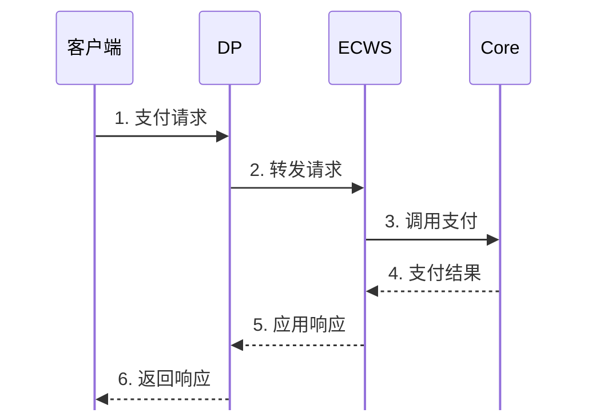
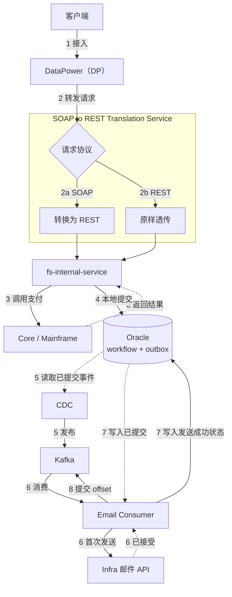
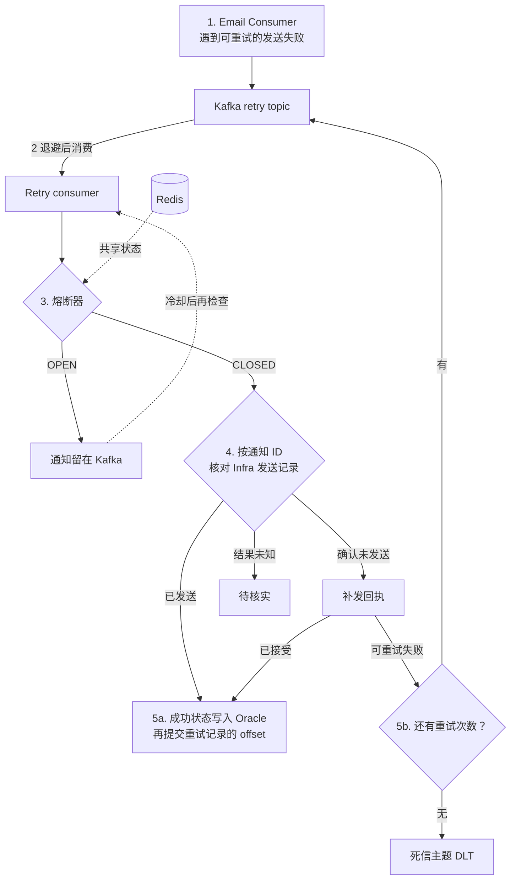

整理日期：2026-11-17。适用于后端岗位的项目介绍、简历深挖与 difficult project 回答。

这份作为主要复习稿：先回忆架构，再讲清个人贡献，用 STAR 串起困难项目，最后练追问。具体 Pod/partition 数、重试秒数和 CDC 参数留在单独的设计参考文档，不放进主讲稿。

**阅读顺序：** 第 1 节架构 → 第 2 节 ownership → 第 3 节英文 STAR → 第 4 节 deep dive。
工作主线按现有个人材料整理；标为“设计推演/实现讨论”的部分用于准备机制问题，不代表已经在项目中实现。需要补回的个人细节集中在第 5 节。

## 1. 架构 recap：先在脑中走完一笔请求

**一句话：** ECWS 是银行和 credit unions 使用的支付编排服务。我重构的是 orchestration 模块，并把 receipt email 从支付主流程拆成异步通知链路。

### 1.1 迁移前后，一笔支付请求怎么走？

**迁移前：一次支付调用的往返**



1. 客户端把支付请求发给 DataPower（DP）。
2. DP 完成鉴权、限流和路由，把请求转给 ECWS。
3. ECWS 调用 Core 执行支付。
4. Core 把支付结果返回给 ECWS。
5. ECWS 生成应用响应，返回给 DP。
6. DP 将响应返回给发起请求的客户端。

**迁移后 · 支付与回执发送成功**



1. **接入。** 客户端将请求发给 DP，由 DP 鉴权、限流和路由。
2. **两种协议共用翻译服务。** DataPower 将 SOAP 和 REST 请求都转给 SOAP to REST Translation Service。服务把 SOAP 转成 REST（2a），对原生 REST 原样透传（2b）。两条分支随后都以 REST 调用 `fs-internal-service`。
3. **执行支付。** 编排服务调用 Core，并接收底层支付结果。
4. **保存结果。** 编排服务在 Oracle 本地事务里写 workflow record，符合通知条件时同时写 outbox。支付请求无需等待邮件发送。
5. **发布通知。** CDC 读取已提交的 outbox 事件并发布到 Kafka。
6. **首次发送。** Email Consumer 调用 Infra 邮件 API 时携带通知 ID，Infra 按此 ID 记录发送状态。API 接受请求后，SMTP 投递由 Infra 负责。
7. **记录发送成功。** Infra 邮件 API 确认接受发送请求后，Email Consumer 向 Oracle 写入这条通知的发送成功状态，等数据库提交成功。
8. **提交消费位点。** 随后由 Email Consumer 向 Kafka 提交这条记录对应的消费位点（offset）。

**迁移后 · 邮件回执重试**



1. 首次发送遇到可重试失败时，Email Consumer 将通知写入 retry topic。
2. 退避时间到后，Retry consumer 消费这条通知。
3. 重试实例检查 Redis 中共享的熔断状态。OPEN 时通知留在 Kafka，冷却后再检查。跳过发送不消耗重试次数。冷却和限速方案见 Q09。
4. CLOSED 时，Retry consumer 用原通知 ID 核对 Infra 发送记录。已发送就直接走 5a；确认未发送才调用邮件 API 补发；查询结果不明确时保留待核实状态。
5. 查到此前已发送，或本次补发已被 API 接受后，Retry consumer 将成功状态写入 Oracle，再提交重试记录的 offset（5a）。如果再次遇到可重试失败，有剩余次数就安排下一次退避，次数耗尽则转入 DLT（5b）。

通知 consumer 的自动重试到 DLT 为止。后续由独立服务核对，原支付已经完成。

**先记住五件事：**

1. DataPower 与 SOAP-to-REST Translator 是不同组件；转换由后者完成。
2. 我负责 `fs-internal-service` 和通知应用链路，Core/Mainframe、Kafka/CDC 平台由其他团队负责。
3. Oracle 本地事务从拿到 Core/Mainframe response 后开始，把 workflow record 和 outbox 一起写入；不跨越之前的远程等待。
4. Kafka 存的是通知事件，付款主流程不需要等邮件服务完成发送。
5. Core 超时结果未知，或 Mainframe 成功但本地持久化失败，由既有 reconciliation service 核实修正；它不是邮件 retry/DLT，也不是我实现的服务。

### 1.2 每个组件为什么在这里

| 组件 | 在这条链路中的作用 | 复述时抓住的点 |
|---|---|---|
| DataPower / Translator | 保留旧接口接入，处理入口职责与协议转换 | 不把这两层都说成自己重构 |
| Orchestration | 协调请求与下游能力，记录本地流程结果 | 我的主要代码范围 |
| Core / Mainframe | 提供底层支付能力与交易结果 | HTTP-facing Core 背后还可能有 MQ request/reply |
| Oracle workflow + outbox | 同时记录本地状态和需要发出的事件 | 保护的是本地原子写入 |
| CDC + Kafka | 将已提交事件发布到异步消费链路 | 平台由其他团队维护，我做应用侧集成 |
| Email Consumer | 消费通知、处理发送和失败恢复 | 讲清重复、重试与“完成”的含义 |
| Reconciliation | 处理支付结果未知和跨系统记录不一致 | 已存在；具体修复到 outbox 的接口仍待核实 |

复习时先沿上面的请求主链路和通知链路走一遍，再补充 Core 背后的 MQ 层次与跨系统失败窗口。

### 1.3 60 秒项目开场

> At Madison-Davis, I worked on ECWS, a payment orchestration service used by banks and credit unions. My main responsibility was refactoring the orchestration module into a Java and Spring Boot service and separating receipt email delivery from the payment workflow.
>
> After we received a response from the Core service, we saved the workflow record and the notification outbox in one Oracle transaction. CDC published the committed events to Kafka, and our email consumer called the infrastructure team’s email API and handled retryable failures and dead-letter messages.
>
> I owned the application-side work and coordinated with the platform and QA teams on integration and releases. The Kafka and CDC platforms were operated by other teams. The key challenge was making notification delivery recoverable without keeping payment requests waiting for the email service.

讲完停一下，让对方决定追架构、consumer，还是项目困难。开场不需要一次报完技术栈版本与所有指标。

## 2. 我的 ownership：具体到应用工作与交接点

### 2.1 可以直接讲的个人贡献

| 我的范围 | 可以怎么说 | 继续追问时从哪里展开 |
|---|---|---|
| 编排模块重构 | “I refactored the orchestration module into `fs-internal-service`.” | 为什么划这个服务边界；请求如何经过下游；本地状态如何保存 |
| 邮件解耦 | “I separated receipt email delivery from the payment workflow.” | 为什么异步；怎样避免本地状态与事件的双写缺口 |
| 通知应用侧集成 | “I worked on the outbox/CDC integration and the email consumer.” | 输入输出契约、事件身份、发送和失败处理 |
| retry / DLT | “I implemented the application-side recovery path for notification failures.” | 暂态与永久错误、退避/jitter、耗尽后转入 DLT |
| 跨团队联调 | “I provided the application requirements and worked with the owning teams to connect the flow.” | DP 的流量提票；CDC/Kafka 的 source、destination、schema |
| 发布与排障协作 | “I worked with infrastructure, QA, and application teams on releases and troubleshooting.” | 自己实际做过的一次验证、日志排查或交接动作 |

这里的“负责”不等于每个相关技术决定都由我独自制定。讨论某个决定时，分清：我接到的目标、我提出的部分、与谁确认、我实际实现的部分。

### 2.2 我依赖的团队与系统

- **DP team：** 维护 DataPower；我通过提票、需求说明和联调打通应用流量。
- **Kafka/CDC 平台团队：** 维护平台与运行环境；我提供应用契约和集成需求。
- **Core/Mainframe 团队：** 提供底层能力；我负责调用和处理应用侧结果。
- **Reconciliation service：** 处理两类支付跨系统不一致；不属于我实现的组件。
- **Infra 邮件团队：** 维护 SMTP，对应用提供邮件 API。我们的职责到 API 调用及其结果处理为止。内部是否有邮件路由由 Infra 确认。
- **基础设施、QA、应用团队：** 协作发布与故障定位，具体事故中的行动需要用真实经历补充。

**短答：**

> My ownership was the orchestration and notification application flow. Our consumer called the email API and handled retries. The infrastructure team managed SMTP behind that API. I implemented the changes within the application and worked with the platform teams on the integration points. I didn't operate the Kafka or CDC platform, and I didn't implement the reconciliation service.

### 2.3 哪些细节先放在待确认区

目前还不能直接写进过去式经历的内容：通知表的唯一约束、atomic claim/租约、完整发送状态机、实际 ack mode、Infra 并发发送去重机制、邮件 UNKNOWN 对账、某一组精确 retry 参数。

被问到这些机制时可以先解释设计原则，再说明项目实际实现需要确认哪一处；别把参考设计里的代码当成自己的生产代码。

## 3. Difficult project：STAR 口语版本

故事主线是**重构编排时，把邮件通知拆成可恢复的异步链路**。困难在于改变了失败和完成的边界：不能只把同步调用换成发消息，还要考虑本地记录、通知意图和下游失败之间怎样衔接。

STAR 用来组织具体经历：背景与任务简短，重点放在自己的行动，结果以可说明的证据收尾。参考 [招聘方的 STAR 建议](https://www.amazon.jobs/content/en/how-we-hire/sde-ii-interview-prep)。

### 3.1 STAR 记忆骨架

| 部分 | 讲什么 | 提醒自己的关键词 |
|---|---|---|
| S — Situation | 旧流程运行在固定服务器上，支付与邮件耦合；有峰时 request 卡住和缺失 receipt 的反馈 | legacy / coupled / missing receipts |
| T — Task | 我负责 orchestration 重构，并把邮件从主流程拆出去，同时保留失败恢复路径 | my scope / decouple / recover |
| A — Action | 同库 workflow/outbox 事务；CDC/Kafka 异步发布；consumer retry/DLT；与平台和 QA 对齐集成与发布 | local transaction / async / recovery / collaboration |
| R — Result | 付款不再等待邮件；通知失败有独立恢复路径；日志与 trace 有助于沿链路排查 | independent / recoverable / traceable |

不要把“request 卡住”直接改写成已经证明的线程池耗尽或连接泄漏；那些不是现有材料确认的根因。

### 3.2 英文口语稿｜约 2 分钟

> One challenging project was separating receipt email delivery from our payment orchestration flow.
>
> The legacy system ran on fixed servers, and payments and receipt delivery were closely coupled. We had reports of requests getting stuck and customers missing receipts, especially during busy periods. My task was to refactor the orchestration module, and I moved email delivery into a separate asynchronous flow.
>
> The difficult part was preserving the connection between the local workflow result and the notification. Simply updating the database and then publishing a message would leave a failure window between those operations.
>
> I used a transactional outbox for that boundary. After receiving the Core response, we wrote the workflow record and the outbox event in one short Oracle transaction. CDC then published the committed event to Kafka, so payment processing didn't have to wait for the email service.
>
> On the notification side, I worked on the consumer and recovery path: retries with backoff and jitter, followed by dead-letter handling when retries were exhausted. I coordinated the event contract with the Kafka and CDC teams and worked with QA and infrastructure on integration and releases.
>
> The result was separate execution and recovery paths for payments and notifications. We could investigate and retry a notification without making the payment request wait. Centralized logging and a global trace ID also helped us follow requests through the flow.
>
> My takeaway was that making a workflow asynchronous also means being explicit about what has completed, what can be retried, and who owns recovery when the result is uncertain.

最后一句是可用的复盘表达，练习时换成自己最认同的体会，不必逐字背。

### 3.3 中文理解版

**S：** 旧系统跑在固定服务器上，付款编排和邮件通知耦合。高峰期出现过请求卡住和用户收不到 receipt 的反馈。这里先讲观察到的问题，不替它编一个已经验证的根因。

**T：** 我接到的任务是重构 orchestration 模块。在这个范围内，我把邮件拆成异步链路，让付款不用等邮件，同时要保留通知失败后的恢复能力。

**A：** 技术上先处理本地双写问题：拿到 Core response 后，用一个 Oracle 短事务保存 workflow record 和 outbox，再由 CDC 发布到 Kafka。然后在通知 consumer 侧处理 retry、backoff/jitter、重试耗尽后转入 DLT。协作上，我负责应用侧契约和集成，与平台、QA、基础设施团队完成联调、发布和排障。

**R：** 付款和邮件有了独立的执行与恢复路径。邮件失败可以单独排查和重试；迁移中的集中日志与 global trace ID 也帮助串联请求。先把这个功能结果讲清，再根据已核实材料补数字。

### 3.4 围绕这个故事练习的追问

1. **Why was this difficult?**——双写窗口、异步失败、跨团队契约，挑自己最熟的一项讲深。
2. **What did you personally change?**——回到编排模块、outbox 集成、consumer/retry 这些实际范围；补一个自己记得的具体代码改动。
3. **Why this design? What alternatives did you consider?**——解释同步邮件、异步队列和 outbox 的取舍；真实评审经过只讲自己记得的过程。
4. **How did you verify it?**——先讲自己实际做过的测试或联调，再补会怎样测试失败窗口；不要把测试建议说成已执行记录。
5. **What would you improve?**——可以讨论完成状态可见性、幂等并发保护或故障演练，但要明确这是复盘方案。

### 3.5 数字只作为核实后的补充

简历里的 **3× 峰值处理能力**和**约 90% 长尾通知失败下降**可以保留为候选结果；讲之前找回比较基线、时间窗口、分母，以及个人改动与整体迁移的关系。

这版口语稿先不使用“超过 99%”或准备稿给出的精确成功定义。若暂时无法核实数字，直接使用上述功能结果即可，不需要用估算填满结尾。

## 4. Deep dive：先练这些问题

下面按一条常见追问路线组织：**为什么做 → 为什么这样设计 → 具体怎么执行 → 失败了怎么办 → 怎么证明做对了**。这是结合公开面试指南和本项目挑选的练习题，不是某家公司的题库或出题概率统计。问法参考 [JavaGuide 项目面试指南](https://www.javaguide.cn/interview-preparation/backend-project-interview-guide.html)。

回答时先讲两三句核心结论，再画图或展开一个失败场景。涉及尚未找回的具体实现，用“项目里确认的是……；如果讨论实现，我会……”衔接。

### Q01. Why did you separate email from payment orchestration?

**先回答：** receipt email 和支付编排有不同的时延要求及失败方式。邮件依赖变慢时，不应该让支付流程继续等；拆开后，通知可以独立重试和恢复。

关键取舍是：同步调用简单、结果直接；异步化改善隔离，但引入事件契约、重复处理、排队延迟和运维成本。不是“微服务一定比单体好”，而是这里有清楚的职责边界。

**追问：为什么不只加机器？** 加容量可以缓解压力，却不消除支付流程对邮件的等待。拆分是否值得，要看用户影响、依赖时延、故障隔离和维护成本。

> Receipt delivery had different latency and recovery needs from payment orchestration. Separating it let us handle notification failures without making the payment workflow wait for email.

### Q02. How did you make the architecture decision? What alternatives did you consider?

把决策讲成四步：**目标与约束 → 可选方案 → 主要取舍 → 验证方式**。架构理由可以解释清楚；当时谁提案、谁拍板、是否做过 PoC，需要补真实经过。

| 方案 | 优点 | 本项目需要考虑的代价 |
| --- | --- | --- |
| 保留同步邮件 | 链路短、实现直观 | 支付流程承受通知等待与失败 |
| 进程内异步任务 | 改动可能较小 | 进程退出后的任务恢复需要额外保证 |
| 数据库提交后直接发 Kafka | 容易理解 | 两步之间崩溃可能漏事件 |
| Outbox + 定时 relay | 本地状态与意图一起提交 | 需处理轮询、重复发布、清理和时延 |
| Outbox + CDC | 由提交后的数据库变化驱动发布 | 增加 CDC 平台依赖与恢复、schema 协作 |

**适合本项目的解释：** 采用 Outbox 来表达可靠的通知意图，再接入已有团队负责的 CDC/Kafka 能力。轮询也可以是合理方案；不能为了突出自己的方案，说它天然不可靠。

**为什么是 Kafka？** 项目已在使用其他团队维护的 Kafka/CDC 能力，个人工作是应用侧集成。可以解释持久化事件、独立消费和恢复的需求；若被要求与其他队列比较，再讨论组织已有平台、事件重放、顺序与运维成本，不能把全公司的平台选型写成自己独自决定。

**继续追问：** 当时最重要的约束是什么？哪个方案是你提出的？哪项验证支持了选择？这三项应来自自己的记忆，不能把上表当成当年开过评审会的证明。[Outbox 模式与 relay 选择](https://microservices.io/patterns/data/transactional-outbox.html)

### Q03. What happens in the database transaction? What does it not cover?

**项目主线：** 收到 Core/Mainframe response 后，本地 Oracle 事务一起写 workflow record 和 outbox。对不需要通知的业务结果，还要按实际资格规则决定是否产生事件。

这段事务不跨越前面的远程等待，也不包含邮件发送。它保证的是同一本地事务里的状态与通知意图，不是 Mainframe、Oracle、Kafka、邮件服务之间的全局原子性。

**失败追问：** 如果 Mainframe 已成功、本地写入失败，已有 reconciliation service 负责核实和修正；其具体修复到 outbox 的交接方式尚未确认。不能回答“Outbox 会自动解决所有不一致”。

### Q04. What if the payment call times out? Would you retry?

超时只表示没有及时收到明确响应，不证明付款失败。要保留同一交易的业务标识，核实真实结果；不能换一个 transactionID 再发一次付款。

材料确认请求里有 transactionID，后端提供同 ID 幂等行为，且已有 reconciliation 处理未知支付结果。具体哪个服务实现幂等、能否直接查询、如何重试，要按真实接口契约说明。

**追问：** 同一个 key 携带不同金额怎么办？这是契约问题，通常应识别冲突，而不是把不同请求当作同一次操作。这里是实现讨论，尚不能声称项目已有某个 payload hash 字段。

### Q05. How did you handle idempotency? Payment and notification are the same thing?

分成两层：

- **支付幂等：** 同一支付意图重试保留 transactionID；防止重复执行资金动作。
- **通知幂等：** 材料中的业务标识是 `transactionId + notificationType`；用于识别同一通知、支持去重；实际唯一范围、字段和并发协议仍需核实，不能仅凭这个 key 保证邮件不会重复发送。

Kafka offset、trace ID、业务幂等 key 各有用途。一次重试可能有新的执行 trace，但不能随意变更其业务身份。

**实现追问：** 如果处理结果完全落在同一个数据库里，可以把“去重记录 + 业务写入”放在一个事务中，用唯一约束/原子操作防并发竞争。发邮件属于外部副作用，不能直接照搬这个保证。[Idempotent Consumer](https://microservices.io/patterns/communication-style/idempotent-consumer.html)

#### How would you configure Kafka for idempotent writes to the retry topic?

**先举一个会重复的场景。** Producer 把通知写入 retry topic，broker 已经追加了记录，但确认响应在网络中丢失。开启幂等 producer 后，客户端自动重发同一批次时，broker 可以依据 producer ID 和分区内的序列号识别重复。本题里的 producer 是应用转发 retry / DLT 记录时使用的客户端；Kafka 平台由平台团队维护。

| 面试官问哪一层 | 参数怎么答 | 保证什么 |
|---|---|---|
| Producer 写入去重 | `enable.idempotence=true`，配合 `acks=all`、`retries > 0`、`max.in.flight.requests.per.connection ≤ 5`（参考取 5） | 同一 producer 会话内，协议层自动重试同一批次，分区日志只追加一次。 |
| Topic 写入持久性 | 每个 partition 的 replication factor 为 3，`min.insync.replicas=2` | 配合 `acks=all`，3 个副本都在 ISR 时等 3 个；只剩 2 个同步时等 2 个；只剩 1 个时写入无法成功确认。 |

3 份副本和最少 2 份同步副本是项目回忆中的数值。Producer 参数来自项目设计参考，生产环境的实际取值以部署配置为准。[Kafka producer 配置](https://kafka.apache.org/41/configuration/producer-configs/#enable.idempotence) · [Kafka topic 配置](https://kafka.apache.org/41/configuration/topic-configs/#min.insync.replicas)

**英文口述**

> For writes to the retry topic, I’d enable producer idempotence, use all acknowledgments, allow retries, and keep at most five requests in flight per connection. That covers a lost acknowledgment: the producer can retry the same batch safely. The topic’s replication factor of three and minimum ISR of two address durability. If the consumer calls our email API twice, that’s a separate problem. I’d check whether the API can deduplicate requests using the same notification ID.

**追问：producer 的 retries 就是那 5 次邮件重试吗？** Producer 重试的是一次 Kafka 写入，重试时间还受 `delivery.timeout.ms` 约束。1、2、4、8、16 分钟是应用重新调用邮件 API 的等待间隔。这两层分别计数。

**追问：retry topic 已写成功，但提交原 offset 前进程崩了呢？** 重启后可能再次消费原记录，应用会发起一次新的 `send()`。即使沿用相同的 Kafka key，也可能再写入一条记录。若要求 Kafka 内的转发和位点一起提交，可以讨论 Kafka 事务。补发前会按原通知 ID 查 Infra 的发送记录，已发送就补记本地成功。

### Q06. Why is checking “already sent” before sending not enough?

两个 worker 可以同时查到“没发过”，然后各发一次。这是 check-then-act 竞争；即使存在唯一索引，也要问约束检查发生在副作用之前还是之后。

**设计推演：** 原子条件更新、唯一约束或 claim 可以限制本地并发，但“某人拿到了处理权”不等于“邮件已经发成功”。项目真实 claim/lease 表尚未确认，不把这套设计说成亲手实现。

**更深一层：** 如果邮件 API 已接受请求，consumer 却在记录结果前崩溃，本地锁仍无法消除外部结果不明的窗口。Retry consumer 用原通知 ID 查 Infra；查到已发送就补记 Oracle 成功，写入提交后再提交 offset。这个查询能恢复丢失的成功记录；并发请求能否在 Infra 侧原子去重仍待确认。SMTP 最终接受也不等于收件人已看到邮件。[SMTP 接受与超时](https://www.rfc-editor.org/rfc/rfc5321#section-4.5.3.2.6)

### Q07. Walk me through the consumer logic.

这是优先练的一题。先讲流程，再讲采用什么框架：

```text
读取事件 → 校验事件类型、必要字段、业务资格
  → 识别稳定业务 key，检查已有结果与并发规则
      ├─ 已确认完成的重复 → 不调用邮件依赖，完成本次处理
      ├─ 正在处理 / 结果未知 → 按协议等待或核实，不能当作已完成
      └─ 允许本次执行 → 调用邮件依赖 → 分类结果
                            ├─ 已完成 → 完成处理
                            ├─ 明确可重试失败 → 可靠转交 retry
                            ├─ 永久失败 → 可靠转交 DLT/处置流程
                            └─ 外部结果未知 → 核实或可靠转交专门处置
  → 在完成或可靠交接之后，才允许推进已提交的恢复位点
```

**项目已确认：** 有 Email Consumer、重试与 DLT、Oracle 回写去重的示意。以上是帮助解释正确性的逻辑骨架；真实状态表、ack mode、未知结果处置实现不能从图中自动补出。

具体读代码时看四个地方：输入契约、业务方法的完成含义、异常如何传播、框架何时确认。`Listener` 和 `EventConsumer` 的名字不同，不改变这些检查点。

### Q08. When should the offset advance? What if the process crashes?

用两个窗口解释：

| 崩溃时刻 | 可能后果 | 要解决什么 |
| --- | --- | --- |
| 已提交的恢复位点越过该记录，业务尚未完成 | 重启后可能跳过未完成工作 | 不要把“已启动异步任务”当处理成功 |
| 业务已完成，位点尚未提交 | 恢复时可能重复执行 | 副作用需要可安全重放或有明确去重/处置机制 |
| retry 转发成功，原位点尚未提交 | 可能再次转发 | 交接也有重复窗口，业务身份应保持稳定 |

规则是“业务完成，或处理责任已可靠交接”，不是“必须等每封邮件最终成功才推进 main”。在采用非阻塞 retry 的设计里，原事件可以先转交到失败通道。

`poll` 推进的读取位置与已提交的恢复位点不同。按分区推进已妥善处理的边界，不能因为后面的记录已完成，就越过前面尚未完成且未可靠交接的记录。

`return`、应用 acknowledgment、broker 上提交完成不是同一个概念。要核对框架配置；项目实际模式待核实，不背成固定的手动 commit。[Kafka 消费位置与提交](https://kafka.apache.org/41/javadoc/org/apache/kafka/clients/consumer/KafkaConsumer.html)

### Q09. How do you classify failures and decide whether to retry?

| 情况 | 回答重点 |
| --- | --- |
| 明确尚未执行的暂态失败、临时拒绝 | 可以考虑有界重试、退避与 jitter |
| 非法 payload、明确永久业务拒绝 | 重复执行通常无效，记录并转失败处置 |
| 认证、证书或全局配置故障 | 需要修复依赖/配置；避免每条消息持续制造流量 |
| 请求可能已被接受，但响应丢失 | 结果未知，不能仅凭 timeout 就认定可安全重发 |

**项目可讲：** 退避和 jitter 把单条通知的重试时间错开。邮件 API 持续出现可重试故障时，retry consumer 通过 Redis 共享熔断状态，暂停补发。单条重试耗尽后进入 DLT，自动补发在这里结束，后续核对由另一个服务负责。

**单条回执的重试节奏。** 这份面试稿采用 5 次指数退避重试，每次调用前分别等待 **1、2、4、8、16 分钟**，并用 jitter 打散同一批通知。若熔断器保持 CLOSED，忽略 jitter、排队和调用耗时，5 次补发会落在首次失败后的第 1、3、7、15、31 分钟。若熔断器为 OPEN，待重试通知继续留在 Kafka，实际补发可能更晚。生产环境的精确配置仍待核实。

**为什么加 jitter？** 让大量失败事件不要同时重试。它不能代替总重试预算和依赖的流量控制。

#### 两态熔断器怎么实现？

项目中，多个 retry consumer 通过 Redis 共享 OPEN / CLOSED 状态，保护同一个 Infra 邮件 API。下面是面试时可以展开的简化实现。阈值和 Lua 写法按设计起点讲，生产配置仍待核对。

1. **统计实际调用。** 每个自然分钟用一个 Redis 桶，全体 retry consumer 共用。每次邮件 API 调用结束，总数加一；遇到超时或表示依赖暂时不可用的错误（如 503），失败数也加一。旧桶自动过期。无效地址等单封邮件错误不计入依赖故障数。
2. **达到阈值就打开。** 在同一个桶里，实际调用至少 **20 次**且失败率 **≥50%**，就用 `SET email:retry:open 1 NX EX 60` 写入共享标记。一段短 Lua 脚本可把计数、计算阈值和写标记合并为原子操作。`NX` 让随后到达的失败结果不会反复刷新这 60 秒。[Redis SET](https://redis.io/docs/latest/commands/set/) · [Redis Lua 原子执行](https://redis.io/docs/latest/develop/programmability/eval-intro/)
3. **冷却后再放行。** 发送前看标记。标记存在即 OPEN，暂停补发，通知留在 Kafka，跳过发送不消耗单条重试次数。标记过期即 CLOSED，按 Infra 可承受的总补发速率释放积压。如果新一轮调用再次达到阈值，就再打开 60 秒。

**三个时间各管一件事。** 自然分钟决定哪些调用放在一起计算失败率；OPEN 的 60 秒从触发那一刻开始计时；1、2、4、8、16 分钟决定某一封通知最早什么时候再试。

#### 围绕这段设计，面试官可能怎么追？

公开面经里，候选人实际被问过如何避免重复通知、进程崩溃后怎么恢复，以及能给出什么重试保证。下面把这些问题套到支付回执上，并补充 Redis 和两态熔断的设计追问。[候选人记录：通知去重、崩溃与重试保证](https://leetcode.com/discuss/post/8377019/) · [候选人记录：通知集成与冷却策略](https://leetcode.com/discuss/post/8385519/)

| 可能的英文追问 | 面试时怎么答 |
|---|---|
| Why do you need both backoff and a shared breaker? | 退避只推迟一封邮件。几千封邮件同时失败时，即使每封都在退避，下游仍可能过载。Redis 让所有实例一起暂停对同一 API 的补发。 |
| Why 20 calls and 50%? Why a fixed window? | 1 次失败除以 1 次调用也是 100%。最小样本数避免小流量误触发；20 次里至少 10 次暂态故障才打开。固定分钟实现简单，但跨分钟的一波失败可能被拆开。最终阈值要用平时的重试流量、故障率和 Infra 容量来校准。 |
| What if two workers trip it at the same time? | 所有实例更新同一桶；脚本原子执行，OPEN 标记只在不存在时创建。已经发出去的请求仍可能返回，熔断针对接下来要发的调用。 |
| What if the API is still down after 60 seconds? | TTL 到期只代表允许再试。恢复时限制所有实例合计的补发速率，否则大家会一起冲向下游。持续故障会重新触发熔断；代价是每轮冷却结束后会放过一批失败请求。 |
| What if Redis is unavailable? | 在这套设计里，我会暂时停掉补发并告警，把待处理通知留在 Kafka。回执允许延迟，支付已完成。读取 Redis 失败与成功读到“标记不存在”必须分开处理。 |
| What if the API accepted the email but the response was lost? | timeout 可以计入依赖故障率，但这封邮件的发送结果未知。重试用原通知 ID 核对 Infra 记录。已发送则跳过补发，先补记 Oracle 成功再提交 offset；查询超时则保留待核实状态。 |
| What if the consumer crashes while the breaker is open? | 消息留在 Kafka。原记录只有在处理完成或可靠交给 retry topic / DLT 后才推进提交位点。重启后可能再次读到同一通知，仍沿用同一业务身份。 |
| How would you verify that recovery is working? | 同时看邮件 API 的暂态失败率、实际补发速率、熔断状态和最老待发通知的年龄。错误率下降但没有出站调用，只能说明还在暂停；恢复后要看到成功发送，积压也逐步下降。 |

### Q10. What happens after a message reaches the DLT? Is replay safe?

在我的链路里，邮件补发次数耗尽后，Retry consumer 把通知写入 DLT，这条通知的自动重试就结束了。后续由独立服务做 reconciliation。它如何取得待核对记录、是否支持人工或批量补发，要看该服务的实现。

**如果被问到 replay 有什么用。** Replay 是把选定的通知事件交回邮件处理流程。例如邮件 API 明确拒绝了请求，故障已修复，回执仍需发送，就可以沿用原通知 ID 重新处理。如果 API 已接受邮件、只是本地成功记录缺失，核实后应修正记录；结果仍未知时，先排查，避免给客户发两封。处理范围只涉及邮件回执，支付已经完成。

### Q11. Do you need ordering? Why not just use the same Kafka key?

先问业务要的是哪种顺序：同一笔支付、同一收件人，还是所有通知？不要默认全局有序。

Kafka 的分区顺序和业务副作用的完成顺序不是一回事。转到不同 retry topic 后，后续事件可能先完成；如果业务要求严格顺序，需重新评估阻塞、版本校验或其他顺序控制，接受相应吞吐代价。

**本项目边界：** 实际邮件顺序要求还需核实，不能把参考稿“无需严格顺序”当成已确认业务要求。[Spring Kafka 非阻塞重试与顺序](https://docs.spring.io/spring-kafka/reference/retrytopic/how-the-pattern-works.html)

### Q12. What does CDC do, and what if it stops?

在这条链路中，CDC 将数据库中已提交的通知意图带到 Kafka；它与邮件 consumer 的处理进度是两段不同流程。

排查时先确认 outbox 是否已提交，再与平台团队检查采集进度、错误和路由。暂停不意味着事件永久丢失，但恢复能力受保留窗口和实际运行配置限制。

我需要能说明应用提供的 source、destination、schema 及事件语义；不需要把平台维护过哪些 LogMiner 参数说成自己的交付。实际 CDC adapter/版本尚未确认。[Debezium Outbox](https://debezium.io/documentation/reference/stable/transformations/outbox-event-router.html)

### Q13. How would you implement the transaction in Spring?

**实现讨论：** 把 workflow 与 outbox 的同库写入放在一个清楚的 service 边界，由外部调用进入 Spring 管理的事务。远程 Core/邮件调用与这段本地写事务分开。

常见检查点：

1. 同对象内部调用是否绕过默认代理，导致预期事务未开启。
2. 异常是否被 catch 后吞掉；实际 rollback 规则是什么。
3. 两个 repository 是否参与同一个事务管理器和数据库事务。
4. 是否启动异步工作后就返回，却误以为事务或消息处理已经完成。

讲机制即可；项目实际方法名、ORM 和异常类型需要查回后再说。[Spring 声明式事务](https://docs.spring.io/spring-framework/reference/data-access/transaction/declarative/annotations.html)

### Q14. How would you structure or refactor the consumer code?

先把“框架接消息”和“业务决策”分开。一个清楚的拆法是：

- adapter 负责转换输入、调用业务、把结果交回框架。
- service 负责资格、已有状态与失败分类。
- gateway 封装邮件依赖；repository 封装本地状态访问。

这是设计讨论，不代表项目采用了这些类名。拆分的目标是规则可以单测，I/O 可以替换，异常和完成信号可见；不用为了面试硬套 Design Pattern。

**追问：**`sendAsync()` 后直接返回有什么问题？必须明确谁观察异步结果，以及失败时处理责任在哪；不能让框架把“任务已排队”误判为“业务已成功”。

### Q15. How did you test correctness and failure recovery?

先讲实际写过或参与过的一项测试，再讲为何它能证明目标行为。以下是应准备的测试设计，不是已执行历史：

| 测试 | 应观察的结果 |
| --- | --- |
| outbox 写失败 | workflow 与 outbox 不留下半个本地事务 |
| 重复事件、并发处理相同 key | 验证已有防重协议及其明确边界 |
| 邮件依赖返回暂态/永久/未知结果 | 进入正确路径，不吞异常当成功 |
| 邮件可能已接受、本地发送状态尚未记录 | 验证未知结果的处置，不把超时直接认定为未发送 |
| 已记录完成结果、消费位点尚未提交 | 验证重投与重复处理，不静默吞掉失败 |
| retry 转发失败 | 不提前释放原事件的处理责任 |
| 新旧 producer/consumer 并存 | 事件格式与业务语义兼容 |

Mock 适合验证业务分支；真实事务、唯一约束、重投和框架交接需要对应的集成验证。不要只说 coverage 百分比。[Microsoft 技术面试中的测试要求](https://careers.microsoft.com/v2/global/en/hiring-tips/technical-interviewing.html)

### Q16. How did you handle event contracts and backward compatibility?

先说明“哪个事件代表什么业务意图”，再谈 JSON 字段。应能区分 event ID、transactionID、通知身份、trace ID 和 schema 版本。

**设计推演：** 优先兼容性增量，先部署能读新旧格式的一侧，验证缺字段/未知字段/错误枚举；重放旧事件也要能处理。实际 schema 和发布先后顺序尚未补全，不把这些原则改写成当年的上线记录。

**SOAP → REST 的真实背景：** 两种请求都先经过独立 Translator。它将 SOAP 转成 REST，将原生 REST 原样透传，再交给 `fs-internal-service` 编排。旧版本保留并给客户迁移窗口；DP 负责鉴权、限流与 routing。具体分批客户、回滚机制和是否全部迁完未确认。

### Q17. Payment succeeded, but the customer did not get the email. How do you investigate?

按一笔业务逐段追，而不是先猜 Kafka 有问题：

1. 核实最终支付结果与通知资格：这笔是否本来就该发 receipt。
2. 查本地 workflow/outbox：意图有没有落库。
3. 查 CDC → Kafka：事件是否被正确发布和路由。
4. 查 consumer、retry/DLT：是否处理、失败或仍在排队。
5. 查邮件侧结果：明确拒绝、结果未知、供应商接受、退信或收件人未见到，分别判断。
6. 确定恢复入口，重放通知不能重新执行支付。

材料支持 Splunk 与 global trace ID；上面是排障方法。讲亲身事故时，要补真实时间线、自己看过的证据和最终根因，不能把通用步骤包装成已经发生的 incident。

### Q18. What would you do if the consumer lag kept growing?

先比较输入与有效完成速率，并看最老消息年龄。然后区分：流量增长、下游变慢、重复失败、热点 key，还是本地 CPU/连接池/线程阻塞。

扩 consumer 可能有用，但还受分区、单条耗时、数据库与供应商配额限制；如果依赖已过载，直接增加并发可能更差。

**恢复追问：** 故障消失后也要观察积压是否真的消退，避免补发风暴。这里讲判断顺序，不需要背 broker、Pod 和分区的精确数量。

### Q19. How do you know the change worked? What did you measure?

先给已确认的功能结果：支付流程与邮件分离，通知失败有独立的重试和处理路径；日志和关联 ID 改善了跨组件排查条件。

若使用简历里的 3× 或约 90%，必须能说明测量对象、before/after、窗口、分母与团队贡献。现有材料缺完整统计依据，先准备定性结果；不要将 `>99%` 当作已核实指标。

要区分“调用已接受”“业务已完成”“用户已收到”；也要区分请求率、处理容量和通知量。架构参数推算不能代替真实效果证据。

### Q20. What did you personally do when working with other teams?

选一件可以讲细的协作：给 DP team 提票打通流量；向 Kafka/CDC 团队提供 source/destination/schema；与 QA、基础设施及应用团队联调或发布。

按 **阻塞点 → 我提供的证据/契约 → 对方负责的动作 → 我如何验收** 讲。ownership 体现在把自己负责的部分做完整，也体现在能清楚说明交接。

**追问：你说服了谁？有什么 disagreement？** 只有确实发生才讲，不把普通联调补成技术冲突。至少准备一个真实 ticket、改动或验收例子。

### Q21. What was the biggest trade-off? What would you do differently?

本项目可讨论的真实取舍是：异步通知隔离了等待，但增加了事件恢复、重复处理和可观测性的复杂度。

复盘可以围绕“更早明确完成语义、失败责任和验收标准”。要用自己的判断解释为什么值得做，不需要声称过去某个团队犯了错。

如果问流量扩大或严格顺序的新要求，先重新澄清目标、测瓶颈，再选方案；不是机械增加 Kafka/Redis/Pod。

## 5. 面试前只补这几处个人细节

这些缺口比记住几十个配置值更有用：

- [ ] 一次你实际参与的架构决定：你的提案、约束、比较过什么、谁评审、怎么验证。
- [ ] 一个你改过的 service/class 或 ticket：原行为、你的改动、测试与交付结果。
- [ ] consumer 的实际入口、业务方法、完成/异常处理，以及真实幂等记录位置。
- [ ] 一个真实故障或发布问题：你看到的证据、做过的动作、最终结果。
- [ ] 如需讲业绩数字，找回对应统计口径；找不到时使用定性结果。

先练 60 秒开场和 2 分钟 STAR，再随机练 Q02、Q05–Q09、Q15、Q17。每题先讲短答，再接受一次追问。

## 6. 这份追问清单参考了什么

检索日期：2026-11-17。中文材料用于观察项目表达与追问方式，招聘方指南用于校准回答结构；技术机制使用官方文档或模式原作者资料，链接已放在相应问题旁。没有把其他人的面经、事故或成果套进本项目。

| 来源 | 本稿采用的部分 |
| --- | --- |
| [JavaGuide：后端项目面试怎么讲](https://www.javaguide.cn/interview-preparation/backend-project-interview-guide.html) | 围绕主链路、具体职责、选型理由和验证结果组织介绍 |
| [二哥：项目经历一定要扎实](https://javabetter.cn/zhishixingqiu/jianli.html#项目经历一定要扎实) | 项目概述、个人工作、难点与结果要能对应起来；不采用其中推广项目或示例业绩 |
| [牛客：一篇后端面经](https://www.nowcoder.com/feed/main/detail/b64c907106aa4d12b5ec416ed8226464?sourceSSR=enterprise) | 一手回忆中出现选型比较、使用场景、消息重复等连续追问；单篇校招背景，不据此推断所有社招面试 |
| [Amazon 官方：SDE II Interview Prep](https://www.amazon.jobs/content/en/how-we-hire/sde-ii-interview-prep) | 用 STAR 讲具体经历，交代做了什么、怎么做、为什么；不沿用该公司的轮次或价值观要求 |
| [Microsoft 官方：Technical interviewing](https://careers.microsoft.com/v2/global/en/hiring-tips/technical-interviewing.html) | 澄清问题，解释选择，讨论测试、错误和边界情况 |

## 7. 材料说明

本文依据个人项目记录、历史开场稿和项目深挖问答整理，保留工作经历的事实边界与待确认项。公开面试指南和技术资料的引用见正文及上节。
