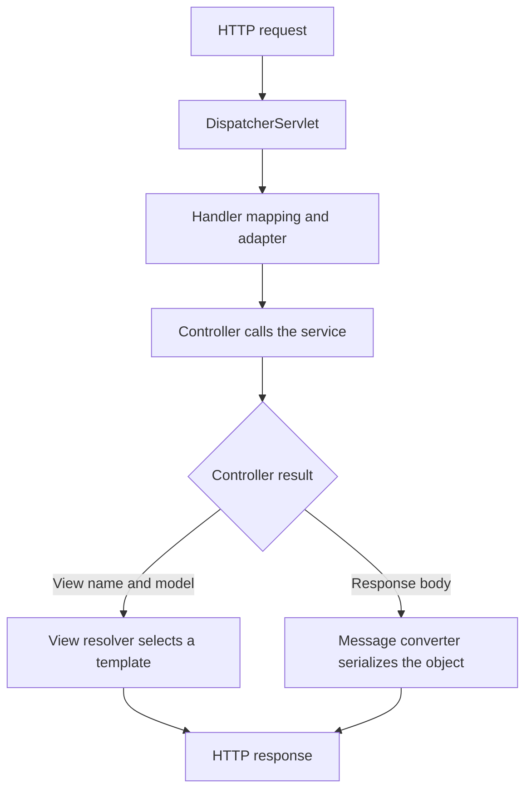

Start with the request path, then decide what the controller should return. A server-rendered page and a JSON API can share the same service layer. The difference is how MVC handles the controller result.

## Spring MVC request flow

`DispatcherServlet` is the front controller for Spring MVC. A handler mapping finds the controller method, and a handler adapter invokes it. The controller translates HTTP input to an application call, while the service holds business rules and the repository handles data access.



For an HTML page, the controller supplies model data and returns a logical view name. The view resolver selects a view, possibly by adding a configured prefix and suffix. The view renders the model into the response. For an API, a message converter writes the response body, typically as JSON. Use `@Controller` for view-based controllers and `@RestController` for controllers whose methods write response bodies by default.

## Request mapping and binding

| Annotation | Example |
| --- | --- |
| `@GetMapping` or `@PostMapping` | Maps an HTTP method and route to a handler. |
| `@PathVariable` | Binds the identifier in `/users/42` from the route `/users/{id}`. |
| `@RequestParam` | Binds a query or form parameter, such as `page` in `/users?page=2`. |
| `@RequestBody` | Deserializes a body such as JSON into a request DTO. |
| `@ResponseBody` | Serializes a return value into the response body. `@RestController` includes this behavior. |

For input validation, put constraints such as `@NotNull`, `@NotEmpty`, `@NotBlank`, and `@Size` on DTO fields and use `@Valid` on the request argument. When a handler needs to inspect its own binding or validation errors, put `BindingResult` immediately after the validated argument and call `hasErrors()`. Otherwise let Spring handle the exception, or use `@RestControllerAdvice` to define a consistent error response.

## REST controller example

This controller assumes that `CategoryService` is registered as a Spring bean. Use DTOs to define the public shape of a response without exposing persistence entities directly.

```java
@RestController
@RequestMapping("/categories")
public class CategoryController {
    private final CategoryService categories;

    public CategoryController(CategoryService categories) {
        this.categories = categories;
    }

    @GetMapping
    public ResponseEntity<CategoriesResponse> listCategories() {
        List<CategoryResponse> items = categories.findAll().stream()
            .map(category -> new CategoryResponse(category.getId(), category.getName()))
            .toList();
        return ResponseEntity.ok(new CategoriesResponse(items));
    }
}

record CategoryResponse(long id, String name) {}
record CategoriesResponse(List<CategoryResponse> categories) {}
```

Call `GET /categories` and check the status, content type, and JSON shape. For outbound HTTP calls, `RestTemplate` is a synchronous client found in older Spring code. Its call holds the caller until a response arrives or a timeout is reached. Keep the base URL in configuration and set timeouts. [Original notes on REST principles](https://chriszzhong.github.io/2023/04/RESTFulAPI/).

## Spring Security and authentication

Authentication establishes **who is calling**. Authorization decides **what that identity can do**. In a servlet application, Spring Security filters process requests before MVC. A filter can authenticate the caller, populate the `SecurityContext`, or return a response before the controller is invoked.

- In a username/password flow, an `AuthenticationManager` delegates to an appropriate provider. A typical provider loads a `UserDetails` through `UserDetailsService` and checks the submitted password using a `PasswordEncoder`.
- In a bearer-token flow, a resource server validates the token and builds an `Authentication` with the resulting authorities. For a signed JWT, validate the signature and relevant claims such as issuer, audience, and expiration before trusting any claims.
- Apply authorization by route or method. With method security enabled, `@PreAuthorize("hasRole('ADMIN')")` checks for the usual `ROLE_ADMIN` authority, while `hasAuthority('unverified')` checks the literal authority. `@AuthenticationPrincipal` exposes the principal to a controller when it needs it.

OAuth 2.0 is a delegation framework. A user might grant a calendar app scoped access to read a calendar. A JWT is a token format and can be used by OAuth 2.0, but the two are independent concepts. A signed JWT has a header, payload, and signature. Its readable payload should never be treated as a secret store.

References: [Spring Security servlet architecture](https://docs.spring.io/spring-security/reference/servlet/architecture.html) · [Original Spring Security walkthrough](https://www.marcobehler.com/guides/spring-security).

## OpenAPI and Swagger UI

OpenAPI describes the paths, schemas, inputs, responses, and security requirements of an HTTP API. Swagger UI displays that description and can make example requests. Treat the document as a contract clients can review alongside the code.

For Spring Boot 3 and Spring MVC, use a compatible release of `org.springdoc:springdoc-openapi-starter-webmvc-ui` from springdoc 2.x. It discovers controller mappings and usually publishes the JSON at `/v3/api-docs` and the UI at `/swagger-ui.html`. Add `@Operation`, `@ApiResponse`, or `@Parameter` where the inferred description needs context. Older tutorials using Springfox and annotations such as `@Api` and `@ApiOperation` describe a different integration. [springdoc for Spring Boot 3](https://springdoc.org/v2/getting-started.html).
