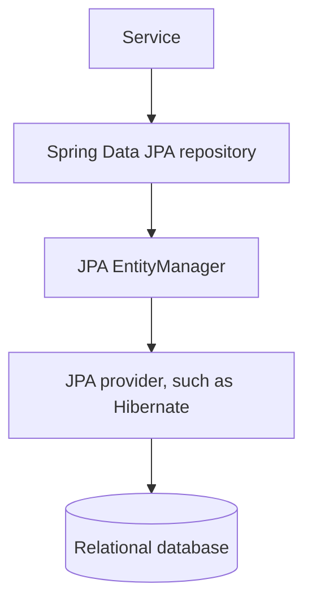

Start by deciding who should own the SQL. Use `JdbcTemplate` when you want to write queries and map results explicitly. Use JPA when you want a provider to manage mapped entities, and add Spring Data JPA when repository interfaces can remove boilerplate. Either way, put multi-step business operations behind a service boundary and test that boundary.

## Connect to a database with JDBC

Add a JDBC starter and a driver, such as `com.mysql:mysql-connector-j` for a Maven project using Spring Boot 3. Use `spring-boot-starter-jdbc` for `JdbcTemplate`. The Spring Data JDBC starter also brings in JDBC support if you need its repository abstraction.

```properties
spring.datasource.url=${DB_URL:jdbc:mysql://localhost:3306/transactionDemo}
spring.datasource.username=${DB_USERNAME}
spring.datasource.password=${DB_PASSWORD}
```

Boot can configure a `DataSource` and `JdbcTemplate` from these settings and the driver on the classpath. Supply an explicit `@Bean` if you need a custom `DataSource`, for example when wiring more than one database. Keep secrets outside the repository.

Here is the question lookup from the original setup exercise. `query` returns a list, `queryForObject` expects a single result, and `update` runs an insert, update, or delete. Pass values as parameters.

```java
@Repository
public class QuestionDao {
    private final JdbcTemplate jdbc;

    private final RowMapper<Question> rowMapper = (rs, rowNum) -> new Question(
        rs.getInt("question_id"),
        rs.getInt("category_id"),
        rs.getString("description"),
        rs.getBoolean("active")
    );

    public QuestionDao(JdbcTemplate jdbc) {
        this.jdbc = jdbc;
    }

    public List<Question> findAll() {
        return jdbc.query("select * from question", rowMapper);
    }

    public Question findById(int id) {
        return jdbc.queryForObject(
            "select * from question where question_id = ?", rowMapper, id
        );
    }

    public int addQuestion(int categoryId, String description, boolean active) {
        return jdbc.update(
            "insert into question (category_id, description, active) values (?, ?, ?)",
            categoryId, description, active
        );
    }

    public int changeStatus(int id, boolean active) {
        return jdbc.update("update question set active = ? where question_id = ?", active, id);
    }
}

record Question(int id, int categoryId, String description, boolean active) {}
```

## JPA and Spring Data repositories

JPA is the persistence specification. Hibernate and EclipseLink are providers that implement it. Spring Data JPA adds a repository layer on top. In a Boot 3 application, `spring-boot-starter-data-jpa` normally supplies Hibernate and its compatible dependencies. Add a database driver and use the datasource settings above.



- `@Entity` marks a persistent class, `@Table` selects its table, `@Id` marks the primary key, and `@Column` customizes column mapping. `@Transient` excludes a property from persistence.
- `EntityManager` manages entities and their lifecycle in a persistence context. JPQL queries entities and their fields using an object model. SQL queries database tables and columns directly.
- `Repository<T, ID>` captures the entity and ID types. `CrudRepository` provides methods such as `save`, `findById`, `findAll`, `existsById`, and `delete`. `PagingAndSortingRepository` adds APIs for `Sort` and `Pageable`. Since Spring Data 3.0, sorting interfaces no longer extend their CRUD counterparts. `JpaRepository` is a common choice that includes both. [Spring Data repository interfaces](https://docs.spring.io/spring-data/commons/reference/repositories/definition.html).

Repository method names can express predicates, sort order, and case handling. Use `@Query` when an explicit query reads better.

```java
public interface PersonRepository extends JpaRepository<Person, Long> {
    List<Person> findByEmailAddressAndLastName(String emailAddress, String lastName);
    List<Person> findDistinctByLastNameOrFirstName(String lastName, String firstName);
    List<Person> findByLastNameIgnoreCaseOrderByFirstNameAsc(String lastName);

    @Query("select p from Person p where p.emailAddress = :email")
    Optional<Person> findByEmail(@Param("email") String email);
}
```

## Transactions and ACID

Suppose account A and account B each start with $1,000. A transfer of $500 should preserve the total and either apply both changes or apply neither.

| Property | In the transfer example |
| --- | --- |
| Atomicity | The debit and credit commit as one unit or are both rolled back. |
| Consistency | A successful transfer must preserve invariants such as the total balance. Application logic and database constraints enforce those rules. |
| Isolation | Concurrent transfers should observe and change balances according to the chosen isolation level and locking strategy. |
| Durability | Once committed, the changes survive failures within the database's durability guarantees. |

Put `@Transactional` on a service method that owns the unit of work, such as `transfer`, or on the class when its methods share transaction defaults. Boot can enable transaction management when a suitable transaction manager is configured. In manually configured Spring, `@EnableTransactionManagement` enables annotation-driven support.

By default, an unchecked exception or an `Error` triggers rollback. If a checked domain exception should also roll back, configure `rollbackFor`. Under proxy-based transaction management, call the transactional method through the bean proxy. An internal call on the same object does not open a new transaction. Also check the SQL or locking strategy separately when a transaction touches concurrently updated rows. [Spring transaction annotations](https://docs.spring.io/spring-framework/reference/data-access/transaction/declarative/annotations.html) · [Original notes on distributed transactions](https://chriszzhong.github.io/2023/06/transaction-in-microservices/).

## Testing Spring applications

A unit test can instantiate a service without Spring and verify its rules in isolation. A slice test such as `@WebMvcTest` or `@DataJpaTest` checks a focused part of the stack with a Spring context. Use a broader integration test to verify real wiring and boundaries such as the behavior of SQL queries or transaction rollback.

### Mockito and JUnit

Boot projects typically use `spring-boot-starter-test` in test scope for JUnit Jupiter and Mockito. Use `@ExtendWith(MockitoExtension.class)` to initialize Mockito annotations in a plain JUnit 5 test.

```java
@ExtendWith(MockitoExtension.class)
class UserServiceTest {
    @Mock
    private UserRepository repository;

    @InjectMocks
    private UserService service;

    @Test
    void returnsUserById() {
        User user = new User();
        user.setId(1L);
        user.setName("test");
        when(repository.findById(1L)).thenReturn(Optional.of(user));

        assertEquals("test", service.getUserById(1L).getName());
    }
}
```

- `@Mock` creates a test double. `@InjectMocks` constructs or wires the real object being tested. `@Spy` wraps an object and calls real methods unless stubbed.
- `when(mock.method()).thenReturn(value)` is the usual syntax. Use `doReturn(value).when(spy).method()` when evaluating the call during stubbing would run an unwanted real method.
- To replace a bean in the test context, use `@MockitoBean` or `@MockitoSpyBean` on Spring Framework 6.2 and later. Older Boot tests often use `@MockBean` and `@SpyBean`. [Spring test context bean overrides](https://docs.spring.io/spring-framework/reference/testing/annotations/integration-spring/annotation-mockitobean.html).
- Use `@BeforeEach` and `@AfterEach` for per-test setup and cleanup. `@BeforeAll` and `@AfterAll` run once per class and are static by default. `@DisplayName` labels tests, and `@Disabled` skips them.

### Code coverage with JaCoCo

Configure `org.jacoco:jacoco-maven-plugin` under Maven build plugins with a version compatible with your JDK. Run `prepare-agent` before tests and bind `report` to `verify`. Then run `./mvnw clean verify` and open `target/site/jacoco/index.html` in a typical single-module project.

Use coverage to find branches no test exercises. Also check what those tests assert. A test can execute a line without checking whether it behaved correctly.
