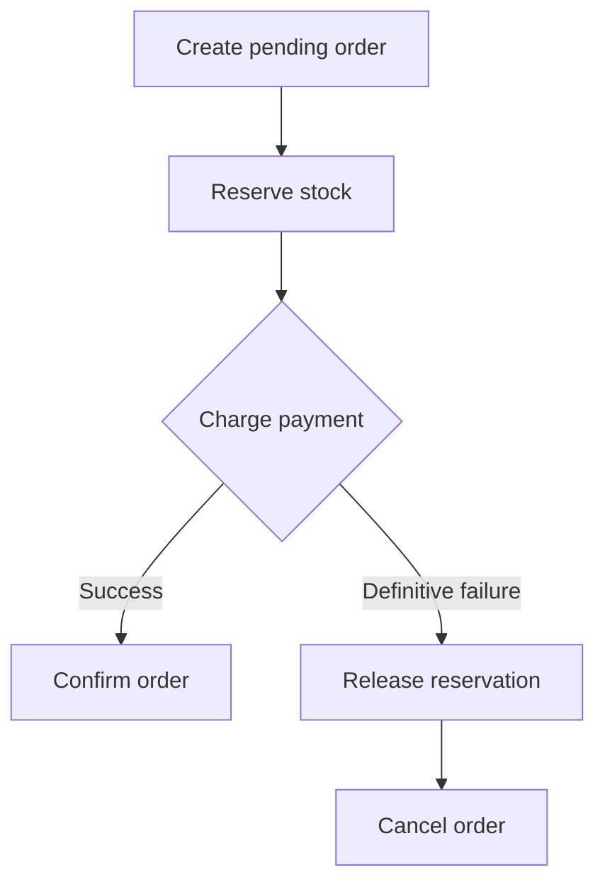

Suppose the order service owns orders, inventory owns reservations, and payments owns charges. A database transaction inside one service cannot atomically update the other two. Start by deciding what must be true immediately and what can converge after an asynchronous workflow.

## 2-phase commit

1. **Prepare.** A coordinator asks each resource manager to prepare. A participant that votes yes records enough state to honor the later decision and can hold locks while waiting.
2. **Decide.** If all participants vote yes, the coordinator records the commit decision and sends it to each participant. Otherwise it decides to abort. On recovery, participants must learn and follow the recorded decision.

Use this when the participants support the required transaction protocol and the operation needs an atomic outcome across them. A slow participant delays the transaction. A prepared participant can block until it learns the decision, so coordinator recovery and durable logs matter. Check each system's actual support for distributed transaction coordination. The SQL or NoSQL label alone is insufficient.

## Saga

A saga breaks one business operation into local transactions. Each step commits independently, so other requests can observe intermediate states. For a failed order, compensation is a new business action, such as releasing the reserved stock. It does not erase the fact that the original step happened.

A timeout during charging is an unknown outcome. Check the payment using its idempotency key before compensating or issuing a new charge. Retry compensation explicitly and surface cases requiring manual review. Use reservation IDs, a durable workflow status, and stable command IDs so repeated deliveries do not create new side effects.

| Approach | Coordination | When it fits |
| --- | --- | --- |
| Choreography | Each service consumes events and emits the next event. | A short workflow with clear event ownership and few branches. |
| Orchestration | A coordinator records progress and issues commands, including compensations. | A workflow with time limits, retries, and branches that need to be visible in one place. |

[Example saga design patterns](https://docs.aws.amazon.com/prescriptive-guidance/latest/cloud-design-patterns/saga-orchestration.html).

## Events and the transactional outbox

In an event-driven flow, services publish facts such as `InventoryReserved`. Interested services subscribe rather than polling the producer for each change. A broker stores and delivers those events. A reactive HTTP framework such as Spring WebFlux can help with non-blocking I/O, while event delivery and transaction consistency still need their own design.

A service that writes a row and separately sends an event has two failure windows. The row can commit without the event, or an event can be seen for an update that never commits. Write the business change and an outbox row in one local transaction. A poller or CDC connector can publish the outbox record afterward. It may publish more than once after a crash, so deduplicate by event ID at the consumer or make the state transition idempotent.

For local transaction boundaries, see [Spring Data and Transactions](/blog/Java%26Spring/2023-04-13-SpringDataJPA#transactions-and-acid). For event processing after publication, see [Kafka and consumer recovery](/blog/DistributedSystem/2024-06-15-kafka-basic#handling-retries-and-errors).
