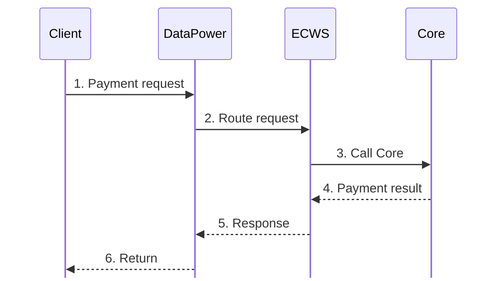
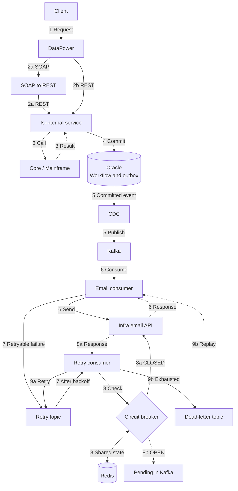

I worked on the ECWS payment orchestration service used by banks and credit unions. I refactored the orchestration module into a Java and Spring Boot service and moved receipt email delivery out of the payment request path.

## Before migration

1. The client submits a payment request to DataPower.
2. DataPower authenticates the request, applies rate limits, and routes it to ECWS.
3. ECWS calls Core to execute the payment.
4. Core returns the payment result to ECWS.
5. ECWS prepares the client response and sends it back to DataPower.
6. DataPower returns the response to the client.

## After migration

1. **Receive the payment.** DataPower still handles authentication, rate limiting, and routing.
2. **Accept both protocols.** SOAP requests pass through the translator (2a). Native REST requests go straight to `fs-internal-service` (2b). Both arrive at the same orchestration service as REST.
3. **Call Core.** The orchestration service calls Core and waits for the payment result.
4. **Record the outcome.** After Core responds, the service writes the workflow record to Oracle. When a receipt is due, it writes an outbox event in the same transaction. The client can receive its payment response without waiting for email delivery.
5. **Publish the receipt event.** Change data capture (CDC) picks up the committed outbox record and publishes it to Kafka.
6. **Request email delivery.** The email consumer calls the infrastructure team's email API. Infrastructure handles SMTP delivery after the API accepts the request.
7. **Retry a temporary failure.** If another attempt is safe, the notification goes to a retry topic. A retry consumer picks it up after backoff.
8. **Protect the email API.** Retry consumers share circuit breaker state in Redis. CLOSED permits a call (8a). OPEN pauses new attempts while pending notifications stay in Kafka (8b).
9. **Recover failed notifications.** A retryable failure with attempts remaining goes back through the retry path (9a). An exhausted notification goes to the dead-letter topic (9b). Once the cause is understood, it can be replayed with the same notification ID. Replay retries the receipt without re-executing the payment.
